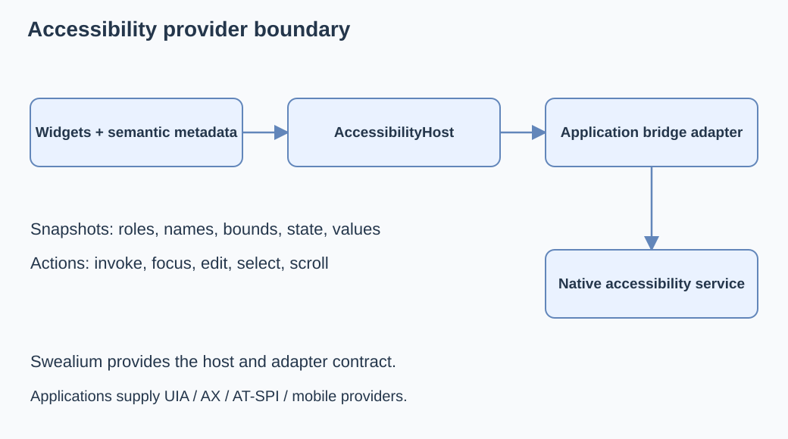

# Accessibility bridge boundary

[Documentation index](README.md) · [API contracts](api/accessibility.md) · [Widget hub](widgets/README.md)

Swealium provides a platform-independent semantic tree and a lifecycle/action boundary for native accessibility adapters. **Native UI Automation, macOS AX, AT-SPI, iOS, and Android providers are not shipped yet.** Attaching no bridge does not make the application screen-reader accessible. The implemented boundary lets adapters integrate without exposing Skia/SDL objects or duplicating widget semantics.



## Describe widgets

```csharp
save.Accessibility.Name = "Save draft";
save.Accessibility.AutomationId = "save-draft";
save.Accessibility.Description = "Save the current document";
editor.Accessibility.Name = "Document title";
editor.Accessibility.ExposeValue = false; // omit its value and selection from snapshots
status.Accessibility.LiveRegion = AccessibilityLiveRegion.Polite;
decorativeGroup.Accessibility.IsHidden = true; // excludes its semantic subtree only
```

Automatic roles cover Window, Group, Button, Text, TextBox, Image/VectorGraphics, and ScrollArea. Button captions and plain/decoded-HTML Text content become default names; TextBox uses Placeholder as a default name and committed Text as its value. Supply meaningful names for images/custom controls. Explicit Name/Role override defaults. Description, AutomationId and HelpText are optional. IsHidden does not alter visual rendering/input. ExposeValue=false redacts TextBox value/selection, but is not password masking or a general data-security boundary.

Each window owns AccessibilityHost at window.Accessibility. CaptureSnapshot returns immutable records with stable widget IDs, parent IDs, roles, labels, window-local logical bounds, ancestor-clipped visible bounds, state flags, supported actions, values/selections, and live-region policy. ID 0 is the window root; IDs are scoped by snapshot WindowId/session and must not be persisted across launches.

```csharp
AccessibilitySnapshot tree = window.Accessibility.CaptureSnapshot();
AccessibilityNode? hit = window.Accessibility.HitTest(new Point(40, 30));
```

Snapshots follow child insertion order for semantic reading order. HitTest separately uses paint priority, rounded hit regions, and scroll clipping, and can identify disabled controls. Hidden/collapsed semantic subtrees are excluded. Offscreen nodes remain represented, allowing adapters to request focus/reveal. Opacity does not independently hide semantics or disable interaction. Bounds are **not screen coordinates**: native adapters must convert logical client coordinates/DPI with their platform APIs and the window's borrowed native handle.

## Actions

TryPerform accepts an AccessibilityActionRequest containing NodeId, action, and optional value/UTF-16 selection/scroll delta. Built-in actions invoke buttons, focus eligible controls, edit/select plain TextBox content, reveal descendants through scroll containers, and scroll ScrollContainer. Focus follows InputManager and reveals offscreen targets. Disabled, stale, hidden, modal-blocked, minimized, or closing-window requests fail safely. Read-only editors reject SetValue.

```csharp
bool accepted = window.Accessibility.TryPerform(
    new AccessibilityActionRequest(node.Id, AccessibilityAction.Invoke));
```

Custom widgets advertise actions through Accessibility.Actions and implement protected OnAccessibilityAction(request). Return true only when the action is handled. Role/action metadata does not implement a native pattern automatically.

## Attach a platform adapter

```csharp
public sealed class MyAccessibilityBridge : IAccessibilityBridge
{
    public void Attach(AccessibilityHost host) { /* bind native provider to host.Window */ }
    public void Publish(AccessibilityUpdate update) { /* update provider cache / raise native events */ }
    public void Detach() { /* unregister native providers */ }
    public void Dispose() { /* release adapter resources */ }
}
window.Accessibility.AttachBridge(new MyAccessibilityBridge());
```

This example shows the boundary, not a working OS provider. AttachBridge takes ownership: attachment sends an initial update; DetachBridge and window disposal call Detach then Dispose, before native window destruction. Failed attachment also detaches/disposes the attempted adapter. A second active bridge is rejected until the first detaches. External native hosts may attach their own adapter using the existing portable native-handle descriptor.

Refresh computes additions/removals, properties, focus, live-region, and tree-order changes. An observed window refreshes during normal Render; explicit Refresh is available. Changed subscribers can observe the same updates without a native bridge. Unchanged trees do not repeatedly publish events. Nodes/updates are detached read-only snapshots, suitable for adapter caches; host/window operations themselves require the UI thread. A native callback arriving on a worker/COM thread must marshal to the window's UI dispatcher. No synchronous cross-thread host proxy is supplied.

Adapters must implement native registration/identity, threading, screen-coordinate conversion, role/pattern mapping, focus/event translation, and native lifetime rules. Full text-range providers, virtualized provider trees, accessible relations, native platform adapters, and screen-reader certification remain separate work. Adapter/callback exceptions propagate like other UI callback failures; cleanup still attempts adapter/native-window release.
