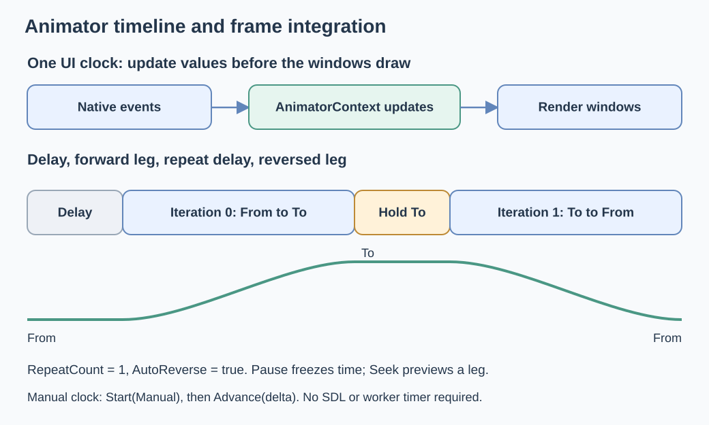

# AnimatorContext

[Documentation index](README.md) · [Public signatures](api/reference.md) · [Application lifecycle](architecture.md)

Namespace: `Swealium.Animation`. Animators interpolate values on the creating thread. Automatic animations use the application's existing frame loop, before window rendering; there is no worker timer per animation and no native backend type in the public API. Manual playback works without SDL or an application session, including in external native hosts.



## Animate a widget

Create and start the animator inside `SwealiumApplication.Run` configuration or a UI callback:

```csharp
using Swealium.Animation;
using Swealium.Graphics;

var animation = new AnimatorContext
{
    From = 0, To = 180,
    Duration = TimeSpan.FromMilliseconds(600),
    Interpolation = Easing.CubicInOut
};
animation.OnUpdate += value => widget.Transform = Transform.Translate(value, 0);
animation.OnCompleted += () => Console.WriteLine("Movement complete");
window.Closed += animation.Dispose;
animation.Start();
```

Use Transform for visual movement without remeasurement. Animating X/Width/Padding or text properties can invalidate layout normally. An animator does not attach itself to a widget or window: subscribe to updates and manage its lifetime explicitly. Animating effects is equally direct: update LayerBlur.Radius, DropShadow.Offset, or another public property from OnUpdate.

## Values and configuration

`AnimatorContext(float from = 0, float to = 1)` is the float convenience class. `AnimatorContext<T>(Func<T,T,double,T> valueInterpolation)` supports other types and custom structures. Generic From/To initially contain default(T); assign meaningful endpoints before starting. The interpolation delegate receives `(from, to, directedEasedFraction)`. It should be a pure, finite value calculation. The generic protected virtual `ValidateValue(T)` defaults to no-op; the float class rejects nonfinite values.

| Property | Default / contract |
| --- | --- |
| `From`, `To` | Float class: 0 and 1; generic: default(T) |
| `Duration` | 300 ms; nonnegative TimeSpan per iteration |
| `Delay` | Zero; initial delay before the first iteration only |
| `RepeatDelay` | Zero; hold the endpoint between iterations |
| `RepeatCount` | 0 additional iterations; -1 infinite; other negative values rejected |
| `AutoReverse` | false; alternate direction on odd zero-based iterations |
| `Direction` | Forward; Reverse initially plays from To toward From |
| `Interpolation` | Easing.Linear; non-null `Func<double,double>` time curve |
| `PlaybackRate` | 1; finite positive multiplier, changeable during playback |

Configuration setters except PlaybackRate reject changes while Delayed, Running, or Paused. Cancel or finish before changing endpoints/timing/easing, then Start again. This avoids partially changing a running timeline. For retargeting, capture Value, Cancel, assign From to the captured value and To to the new target, then Start. Restart reuses current configuration; it does not automatically retarget From.

Finite duration is `Delay + Duration * (RepeatCount + 1) + RepeatDelay * RepeatCount`. RepeatDelay does not follow the final iteration. AutoReverse does not implicitly add a return leg: set RepeatCount=1 for one outward and one return iteration. With RepeatCount=-1, playback continues until cancelled, disposed, or explicitly finished. Infinite playback with both Duration and RepeatDelay zero is rejected at Start. Finite zero-duration/zero-gap runs publish the final endpoint once and complete immediately; they do not loop through callbacks for each instantaneous iteration.

## Controls

| Method | Contract |
| --- | --- |
| `Start(AnimationClock clock = Application, CancellationToken cancellationToken = default)` | Starts a new run; throws if already active |
| `StartAsync(...)` | Same arguments/behavior, returns this run's `Task<AnimationState>` |
| `Restart(AnimationClock clock = Application, CancellationToken cancellationToken = default)` | Cancels an active run with Replaced, then starts another; defaults to Application even if the prior run was manual |
| `Pause()` | Freeze the last sampled value; returns false unless Running or Delayed |
| `Resume()` | Continue a Paused run without counting paused wall time; returns false otherwise |
| `Seek(double progress)` | Set current iteration's normalized clock progress in [0,1]; skips initial delay; publishes a value without completing; Paused stays paused |
| `Finish()` | Publish the final iteration's endpoint and complete; infinite playback finishes the current iteration; works while paused/delayed |
| `Cancel()` | Keep the current value and cancel with Requested; returns false if not active |
| `Advance(TimeSpan delta)` | Advance a started Manual-clock run by nonnegative time, multiplied by PlaybackRate |
| `Dispose()` | Unregister and cancel any active run with Disposed; state becomes Disposed; repeated disposal is harmless |

Pause, Resume, Cancel and Finish return bool indicating whether they acted. Start/Restart create independent completion tasks. StartAsync captures the new task even if a callback starts another run synchronously. If a Replaced cancellation callback explicitly starts a new run, Restart leaves that new run in place. Invalid clock/session requests are rejected before replacing an existing run.

Seek is a preview within the **current iteration**, before its direction/easing. It resets the automatic wall-clock origin so time spent before the seek is not counted twice. Seeking to 1 does not itself complete; the next advancing update may complete or enter the next iteration. Finish bypasses remaining delay and repeats. Changes requested by callbacks take precedence: for example cancelling or pausing inside the last OnUpdate prevents a stale completion from firing afterward.

## Observed state

| Read-only member | Meaning |
| --- | --- |
| `State` | Idle, Delayed, Running, Paused, Completed, Cancelled, Faulted, or Disposed |
| `IsActive` | State is Delayed, Running, or Paused |
| `Value` | Last published value; initialized to the directed starting endpoint before OnStarted |
| `Progress` | Forward clock progress [0,1] within the current iteration, before direction/easing |
| `EasedProgress` | Fraction passed to value interpolation after easing and direction; can overshoot |
| `Iteration` | Zero-based Int64 iteration index |
| `Elapsed` | Scaled timeline time, including initial/repeat delays; clamps at a finite run's end and at TimeSpan.MaxValue for display |
| `Completion` | Null before first Start; otherwise the latest run's Task |

Reverse direction uses `1 - Interpolation(Progress)`. Exact endpoints always return the configured From/To rather than a slightly inaccurate custom curve result. Repeat-delay intervals hold Progress=1 and the directed endpoint; they do not generate repeated unchanged updates. Large elapsed-time jumps sample only the current/final position, not every missed frame or iteration. Extremely large infinite-playback iteration indices beyond the supported Int64 range fault rather than overflow.

## Callbacks

Callbacks are public events:

| Event | Timing |
| --- | --- |
| `OnStarted` (`Action`) | Once when Start schedules the run, even when Delay is nonzero |
| `OnUpdate` (`Action<T>`) | Initial sample, subsequent active samples, explicit Seek and final sample |
| `OnCompleted` (`Action`) | After the final update and transition to Completed |
| `OnCancelled` (`Action<AnimationCancellationReason>`) | After cancellation; reason is Requested, CancellationToken, Replaced, ApplicationStopped, or Disposed |
| `OnPaused`, `OnResumed` (`Action`) | After the corresponding state change |
| `OnRepeated` (`Action<long>`) | Latest iteration index when a sample crosses an iteration boundary |
| `OnFailed` (`Action<Exception>`) | Active interpolation/validation/callback failure, after transition to Faulted |

Typical order is OnStarted → OnUpdate(start) → updates → OnUpdate(end) → OnCompleted. Initial/repeat delays hold the current value without per-frame update churn. A boundary sample updates observed state, calls OnRepeated if needed, then OnUpdate. Skipped iterations coalesce into one OnRepeated with the latest index. An already-cancelled token cancels immediately without OnStarted/OnUpdate. Zero duration may publish only the final sample.

Callbacks may cancel, pause, seek, finish or start a later run. Revision checks prevent the earlier callback path from publishing stale state or completing the replacement run. Configuration still follows the active-run freeze rule. Each event is a normal .NET multicast event: a throwing subscriber interrupts later subscribers.

## Await, cancellation and errors

```csharp
var result = await animation.StartAsync(cancellationToken: cancellationToken);
if (result == AnimationState.Completed)
{
    // In a UI callback, await resumes through the application synchronization context.
}
```

Completion returns Completed or Cancelled; cancellation is a normal result, not a cancelled Task/OperationCanceledException. An active update/interpolation failure faults the Task and propagates the original exception from Start/Advance/the application loop. OnFailed is notified; its own exception is suppressed to preserve the original failure. An OnCompleted exception propagates but does not change an already-completed task; similarly, OnCancelled exceptions leave cancellation settled. An old run's callback exception never faults a newer run it started.

Tokens are checked on Start and subsequent frame/manual updates, including while paused. No token callback runs on a worker thread. For manual playback, call Advance(TimeSpan.Zero) to process cancellation without consuming time. Callbacks run synchronously on the creating thread. Task continuations use asynchronous scheduling; awaiting in UI code captures the session's synchronization context normally. Keep a window/session alive while UI continuations are still required, as with other asynchronous application work. Do not block the UI thread with Wait or Result on an incomplete task.

All mutating methods/setters and Dispose enforce the creating thread; readings should also stay on that thread. Automatic Start additionally requires the active application UI thread and is rejected outside Run/during shutdown. When the last window closes, application-owned animations are cancelled during session cleanup, including paused animations. Animation failures use the existing application failure/cleanup path. Animations do not keep Run alive after windows and queued callbacks are gone. Closing one of several windows does not automatically cancel animations targeting that window: dispose/cancel from its Closed event.

## Typed interpolation and easing

```csharp
var position = new AnimatorContext<Point>(AnimationValues.Point)
{
    From = new(10, 20), To = new(240, 80),
    Duration = TimeSpan.FromSeconds(1),
    Interpolation = Easing.CubicBezier(.42, 0, .58, 1)
};
position.OnUpdate += p => widget.Transform = Transform.Translate(p.X, p.Y);
position.Start();
```

`AnimationValues` provides Double, Float, Point, Size and Color method groups with `(from,to,double progress)` signatures. Numeric components require finite endpoints/progress/results. Color accepts only solid colors, interpolates sRGB byte channels including alpha, and clamps/rounds overshoot to [0,255]. It does not interpolate gradient objects or perform linear-light/premultiplied color blending. Generic custom values may implement their own policy.

`Easing` exposes Linear, QuadraticIn/Out/InOut, CubicIn/Out/InOut, SineInOut, ExponentialOut, BackOut and BounceOut. Each takes normalized progress in [0,1] and rejects invalid/nonfinite inputs. `CubicBezier(x1,y1,x2,y2)` returns a curve; X controls must be finite in [0,1], Y controls finite. `Steps(int count, bool jumpAtStart = false)` returns a stepped curve; count must be positive. Custom Interpolation delegates may produce finite overshoot, but NaN/infinity faults the run. BackOut and some Bezier curves deliberately overshoot: clamp values in OnUpdate before assigning properties such as Opacity that reject out-of-range inputs.

## Manual clock and tests

```csharp
using var animation = new AnimatorContext(0, 100)
{
    Duration = TimeSpan.FromSeconds(1)
};
animation.Start(AnimationClock.Manual);
animation.Advance(TimeSpan.FromMilliseconds(250)); // Value == 25
animation.Pause();
animation.Advance(TimeSpan.FromSeconds(5));         // Still 25
animation.Seek(.75);                              // Value == 75, still paused
animation.Resume();
animation.Advance(TimeSpan.FromMilliseconds(250)); // Completed, Value == 100
```

Automatic timing uses monotonic Stopwatch timestamps and catches up after slow frames. It shares the application's approximately 16 ms frame loop, not a real-time or refresh-rate guarantee. Hidden/minimized windows skip drawing but application animations keep advancing while the session has live windows. Manual hosts choose their own update cadence and must call Dispose/Cancel themselves; no SDL initialization is required.

Run `dotnet run --project samples/Swealium.Sample -c Release -- --animation-demo` for movement, color, shadow and opacity with restart, pause/resume, seek, finish, cancel and playback-rate controls. The regression suite uses a manual clock for exact boundaries and headless application sessions for real UI-loop/async/shutdown behavior.
