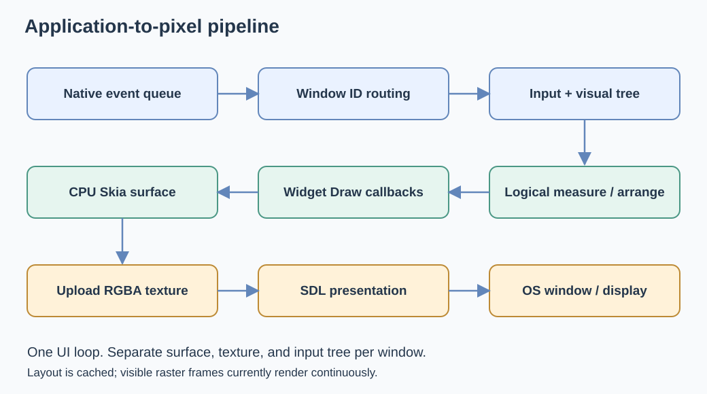

# Architecture and lifecycle

[Documentation index](README.md) · [Windowing API](api/windowing.md)

## Retained state and immediate drawing

The visual tree persists between frames. Widget properties and container child collections are the retained model. Every visible frame, Swealium traverses that tree and asks each visible widget to draw. DrawingContext is a short-lived drawing interface, not the retained model.

Container owns its children; each widget may have one parent and one input-tree root owner. Duplicates and cycles are rejected. IsVisible=false collapses layout and suppresses drawing/input. IsEnabled=false preserves space and rendering but suppresses input for the subtree.

## One application, many windows

Run establishes one application session and UI synchronization context. Windows are registered by their portable numeric Id. A native event is delivered only to the matching live window; global quit requests closure of all registered windows.

Each window owns its visual root, InputManager, native window, presentation renderer, Skia bitmap/surface, and streaming texture. Independent windows share the application loop but not their widget trees or surfaces. Owned windows have a separate native ownership hierarchy.

The loop drains a bounded batch of queued UI callbacks, disposes requested closures, polls events, renders a snapshot of remaining windows, and disposes new closure requests. Native operations that create/close windows during callbacks do not invalidate the active registry enumeration.

## Frame path

1. Query the logical client size and run invalidated layout.
2. Validate focus/capture and synchronize native text input.
3. Query physical output size; recreate raster storage and texture when it changes.
4. Clear the surface to Background.
5. Scale logical coordinates to physical pixels.
6. Invoke window Paint/OnPaint behind the visual tree.
7. Draw widgets in ascending sibling ZIndex, using rounded clipping and local translation.
8. Flush CPU drawing, upload RGBA bytes to the SDL texture, and present.

The application uses one approximately 16 ms frame clock. It is not a real-time scheduling guarantee. Hidden/minimized windows stay alive but skip Render. Layout is cached until invalidated; visible frames currently render continuously. A mutation made during a drawing callback may be arranged on the next layout pass; do not use Draw as the place to continually mutate geometry.

## Threading and asynchronous work

Native window access requires the creating UI thread. Widget and InputManager access are UI-thread conventions, not generally enforced by every property. Run must start on the process main thread.

Await in a UI callback normally captures the installed synchronization context and resumes on the UI thread while the session is running. ConfigureAwait(false) deliberately leaves that guarantee. Use background work for expensive non-UI computation, then resume on the captured context before touching a window/tree. Do not synchronously wait on a pending dialog task: the UI loop must keep running to complete it.

Cross-thread SynchronizationContext.Send is unsupported. The context ignores Post after shutdown; detached work is not kept alive by the application. A task that needs a UI continuation must finish while a window/session remains alive.

## Ownership and failure

RequestClose is cancelable; Dispose is immediate. Before destroying an owner, Swealium disposes its owned descendants, input root, surface, renderer, and native window, then unregisters it. Closed and dialog completion happen after native cleanup.

Exceptions escaping configuration, input, layout, painting, or UI callbacks terminate Run. Cleanup still attempts all remaining windows. The first application/cleanup failure is rethrown after session teardown. Handle recoverable application errors inside your callbacks.

Drawing contexts are invalidated after callbacks, including when drawing throws. Never store, dispose, or use them on another thread. Framework resources have deterministic disposal; there is no native-resource finalizer to rescue abandoned standalone windows.

## External native hosts

The public window constructor can be used by an external host that has already initialized SDL video. Such a host must pump events, render/close windows, own shutdown, and supply its own UI synchronization context. The current public API does not provide a complete mobile host/event-pump adapter; use the managed Run path for supported desktop applications. Mobile native hosts remain future work.

