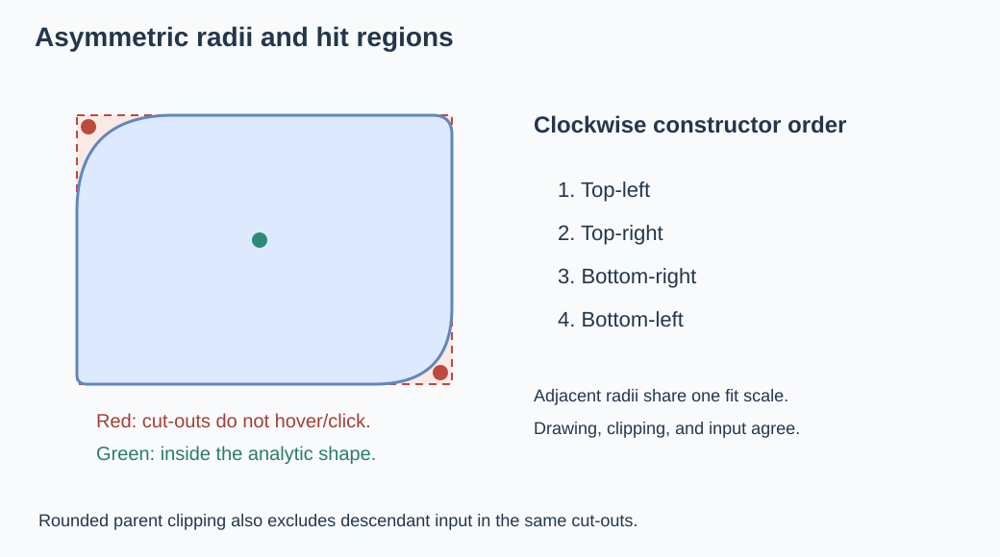

# Drawing, radii, and DPI

[Documentation index](README.md) · [Graphics contracts](api/graphics.md)



## Logical units and frame scope

DrawingContext is provided to Widget.Draw and window Paint. It supports filled/stroked rectangles, ellipses, lines, single-line text, and text measurement. All positions, dimensions, radii, font sizes, and stroke widths use logical units.

The backend scales the window's logical client size into its physical drawable size. Do not multiply drawing coordinates or pointer coordinates by PixelDensity yourself. Background Paint runs before the visual tree. A widget's context is already translated into local coordinates and clipped according to its rounded bounds and ancestors.

Contexts expire after callbacks, including exceptional returns. Retaining and using one afterward throws ObjectDisposedException. You do not own its resources. The current API does not expose a native canvas, transform stack, arbitrary paths, images, shaders, or drawing-context disposal.

## Shapes and colors

```csharp
public override void Draw(DrawingContext drawing)
{
    drawing.FillRectangle(new Rect(0, 0, ActualWidth, ActualHeight),
        new Color(40, 65, 110), Radii);
    drawing.StrokeRectangle(new Rect(1, 1, ActualWidth - 2, ActualHeight - 2),
        Color.White, new CornerRadii(8), 2);
    drawing.DrawLine(new Point(8, 8), new Point(40, 30), Color.White, 2);
}
```

Use meaningful nonnegative geometry and finite dimensions. Rect.Contains includes left/top but excludes right/bottom. Negative or zero rectangle extent cannot contain a point. Drawing primitives currently perform limited validation; they are not general geometric sanitizers.

Color uses byte R/G/B/A values, with constructor alpha defaulting to 255. default(Color) is transparent black because it is a value type. Color.Transparent, White, and Black are provided. Alpha is used in raster drawing; a transparent background does not create an OS-transparent window.

## Independent radii

CornerRadii arguments go clockwise: top-left, top-right, bottom-right, bottom-left. Radii are finite, nonnegative circular radii. If adjacent radii would overlap, Normalize scales all four by a common factor to fit both axes. This prevents the drawing and input boundary from disagreeing.

The uniform-radius FillRectangle/StrokeRectangle overloads remain available. For per-corner strokes the argument order is (bounds, color, radii, thickness). For the uniform stroke it is (bounds, color, thickness, cornerRadius).

Widget.Radii clips the entire widget subtree by default. A custom widget should also pass Radii when drawing its own rounded fill, particularly if ClipToBounds=false. A custom nonrectangular hit shape can override ContainsPoint; that alone does not change drawing or clipping.

## Text

DrawText uses a baseline origin, not a top-left text origin. MeasureText returns advance width and a font ascent/descent height. It uses a system default typeface and does not provide line wrapping, font-family selection, complex shaping, or per-glyph fallback APIs.

Button measures its text intrinsically and adds padding; custom text widgets may override MeasureContent using their own size data. The public drawing API does not provide a context outside a frame, so do not try to retain one for measurement during later layout.

Linux needs the fontconfig-enabled native package and installed fonts for the default typeface. An empty/missing font environment can yield no useful text even while shapes draw correctly.

## Performance model

Each visible frame is rasterized on the CPU, then its full pixel buffer is uploaded to a streaming texture. This is not Skia GPU rendering. Resizing reallocates the bitmap/surface/texture. Keep drawing and input callbacks short; cache application data rather than frame-scoped contexts. Layout is cached, but rendering is not yet invalidation-driven.

