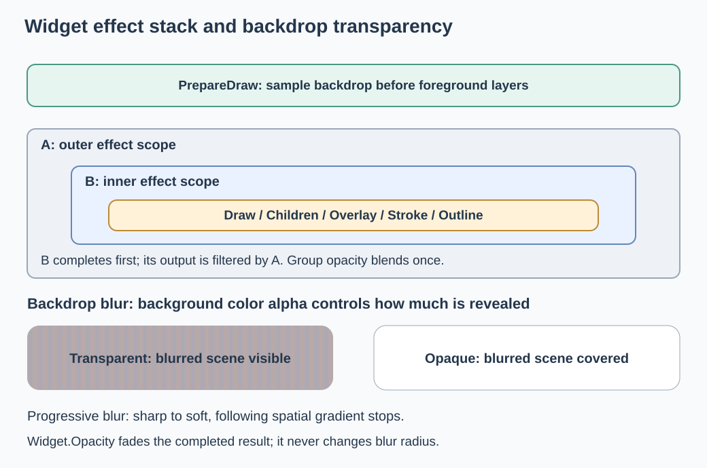

# Widget effects

[Documentation index](README.md) · [Widget base](widgets/widget.md) · [Public signatures](api/reference.md)

Every `Widget` has an initially empty, read-only `Effects` property containing a mutable `WidgetEffectCollection`. Effects work on custom widgets, containers, text, images, scroll/list controls and DrawingCanvas. Public descriptors and hooks use Swealium types only. There are no public backend handles or native filters to dispose.



## Add effects

```csharp
using Swealium.Graphics;
using Swealium.UI;
using Swealium.UI.Effects;

var card = new Container
{
    Width = 300, Height = 180, Radii = new(20),
    Background = new(255, 255, 255, 45),
    Margin = new(20), Padding = new(18)
};
card.Effects.Add(new DropShadow
{
    Offset = new(0, 8), Radius = new(10, 10), Color = new(0, 0, 0, 120)
});
card.Effects.Add(new BackdropBlur(12));
card.Children.Add(new Text { Content = "Glass panel" });
```

Backdrop blur filters **previously painted content**, before this widget paints. A transparent background reveals it; an opaque background covers it completely. Semitransparent colors tint the blurred background. This includes gradient stop alpha. `Widget.Opacity` changes the final group compositing amount and never changes the blur radius. Making an opaque card half opaque fades it over the original scene; it does not turn its opaque background into glass. Text/content is sharp with BackdropBlur and blurred with LayerBlur.

An invisible, zero-opacity, or zero-scale widget does not run effects. Effects do not alter layout, padding, desired size, scrolling extent, pointer regions or accessibility geometry. Reserve margin for large shadows. Expanded output can escape the widget's **own** rounded clip; ancestor clips, including scroll viewports, still apply. Backdrop effects themselves always use the widget's rounded rectangle even when ClipToBounds is false.

## Order and lifecycle

`Swealium.UI.WidgetEffect` is an abstract, managed base with a protected default constructor:

| Member | Default / contract |
| --- | --- |
| `IsEnabled` | `true`; false skips all hooks and drawing scopes |
| `ReadsBackdrop` | Virtual `false`; custom backdrop readers override with true so ancestor opacity groups preserve prior content |
| `PrepareDraw(DrawingContext, Widget)` | Virtual no-op; called for each enabled entry, in list order, **before any content-effect scope opens** |
| `Begin(DrawingContext, Widget)` | Virtual null; return an IDisposable scope wrapping this effect and the rest of the stack |
| `PreDraw(DrawingContext, Widget)` | Virtual no-op; paint behind the remaining stack and widget |
| `PostDraw(DrawingContext, Widget)` | Virtual no-op; paint above the remaining stack and widget |

For `[A, B]`, the content sequence is:

```text
A.PrepareDraw, B.PrepareDraw
A.Begin → A.PreDraw
  B.Begin → B.PreDraw
    Draw → descendants → DrawOverlay → Stroke → Outline
  B.PostDraw → dispose B scope
A.PostDraw → dispose A scope
```

The first entry is the **outermost** effect: B's completed output is input to A. For example `[ColorFilter(grayscale), DropShadow(blue)]` grayscales the shadow as well; reversing them leaves the outer shadow blue. BackdropBlur and backdrop-target ProgressiveBlur paint in PrepareDraw so they can read the scene before same-widget shadow/blur layers isolate content. Content filters subsequently affect the widget's foreground subtree; they do not refilter this prepared backdrop. Multiple backdrop effects run sequentially in list order.

Coordinates are widget-local, after its position/Transform and the ancestor clip. Hooks have access to ActualWidth/Height, ContentBounds and Radii. Contexts expire after the render invocation; do not store them. The renderer always releases returned scopes and native saved state on exceptions. PostDraw is a drawing hook, not a finally hook: it is skipped if inner rendering fails. Put cleanup in the returned IDisposable. Invalid custom scope nesting is rejected; abandoned native scopes are recovered at the callback boundary.

`WidgetEffectCollection` supports the standard Collection operations: Add, Insert, indexed replace/read, Remove, RemoveAt, Clear, Count, enumeration and CopyTo. Null entries throw ArgumentNullException. Structural mutation while its widget is rendering throws InvalidOperationException, including from Draw and descendant callbacks. Change the stack between frames on the UI thread. Effects can be reused on multiple widgets; custom implementations must keep per-invocation state in local scopes, not shared instance fields. The framework does not dispose the effect object or caller-owned resources when removing an entry.

## Built-in effects

Namespace: `Swealium.UI.Effects`. All inherit IsEnabled and the lifecycle above. Mutable properties should be changed between frames.

| Effect | Constructors and public settings | Defaults |
| --- | --- | --- |
| `LayerBlur` | `(float radius = 8)` or `(Size radius)`; `Radius`, `EdgeMode` | Sigma `(8,8)`; Transparent source edges |
| `BackdropBlur` | Same radius constructors; `Radius`, `EdgeMode`; ReadsBackdrop=true | Sigma `(8,8)`; Clamp edges |
| `DropShadow` | `()`; `Radius`, `Offset`, `Color`, `ShadowOnly` | Sigma `(8,8)`, offset `(0,4)`, solid black alpha 110, false |
| `ProgressiveBlur` | `(BlurGradient gradient, BlurTarget target = Layer)`; `Gradient`, `Target`, `EdgeMode` | Required gradient; Layer target; Clamp edges |
| `ColorFilter` | `()` or `(ColorMatrix matrix)`; `Matrix` | Identity matrix |

**Gaussian blur:** Radius is Gaussian standard deviation (sigma) in logical pixels, not a hard cutoff or an opacity amount. Width/height independently control horizontal/vertical spread. `new LayerBlur(new Size(12,0))` smooths horizontally only; `(0,12)` vertically only; `(0,0)` leaves the image sharp. Transparent source alpha remains transparent and soft silhouettes spread according to their alpha. LayerBlur includes children, overlay, stroke and outline.

**Source edges:** `BlurEdgeMode.Transparent` samples transparent pixels outside the source; Clamp extends edge pixels; Repeat tiles; Reflect mirrors. These control source sampling, not output clipping. Native drawing clips and isolated source layers also bound the available input; tiling does not invent previously undrawn content.

**DropShadow:** uses the completed subtree's alpha, not a rectangular layout box. Transparent holes and rounded corners stay shaped; children and decorative borders participate. ShadowOnly=true removes the original foreground and draws only its shadow. Color must be a solid Swealium Color; gradients are rejected. For a glow, use offset `(0,0)` with a colored shadow. To stack independent shadows of the original source, draw them in a custom effect; nested DropShadow entries also shadow earlier rendered shadows according to their nesting.

All uniform radii and BlurStop.Radius values must be finite in `[0,512]`. Nonfinite offsets, invalid enums, negative radii, or out-of-range opacity throw ArgumentOutOfRangeException. Gradient/matrix properties reject null with ArgumentNullException. DropShadow rejects gradient colors with ArgumentException.

## Progressive blur gradients

`BlurGradient` is immutable and reusable. It interpolates **blur radius**, not widget opacity. `BlurStop(float Offset, float Radius)` holds a normalized position and sigma. Between adjacent stops, radius changes linearly. A fixed set of Gaussian images is spatially blended, giving a continuous approximation to variable-radius blur rather than a fade between a sharp image and one maximally blurred image.

```csharp
var blur = BlurGradient.Linear(
    start: new(0, 0), end: new(0, 1),
    stops: [new(0, 0), new(.3f, 0), new(.8f, 10), new(1, 18)],
    quality: 8);
card.Effects.Add(new ProgressiveBlur(blur, BlurTarget.Backdrop));
```

Factories and geometry follow color gradients:

| Factory | Geometry |
| --- | --- |
| `Horizontal(params BlurStop[])` | Linear `(0,0)` to `(1,0)` |
| `Vertical(params BlurStop[])` | Linear `(0,0)` to `(0,1)` |
| `Linear(Point start, Point end, IEnumerable<BlurStop>, ...)` | Any direction; reverse endpoints to reverse the ramp |
| `Radial(Point center, float radius, IEnumerable<BlurStop>, ...)` | Circular distance from center |
| `Elliptical(Point center, Size radius, IEnumerable<BlurStop>, ...)` | Independent ellipse axes |
| `Sweep(Point center, IEnumerable<BlurStop>, ...)` | Angle around center, full 360 degrees |
| `Diamond(Point center, Size radius, IEnumerable<BlurStop>, ...)` | Manhattan-distance ramp |
| `Square(Point center, Size radius, IEnumerable<BlurStop>, ...)` | Chebyshev-distance ramp |

Each factory except Horizontal/Vertical also accepts `GradientSpread spread = Pad`, `GradientUnits units = Relative`, `int quality = 8`. Pad extends endpoint values, Repeat tiles, Reflect mirrors, Decal discards outside the gradient domain. Relative coordinates resolve against local widget bounds; relative circular radius uses the smaller dimension. Absolute coordinates/radii use local logical pixels. The geometry Radius of Radial/Elliptical/etc. controls **where the ramp ends**, independently from each stop's blur sigma.

Read-only properties: `Stops`, `Kind`, `Spread`, `Units`, `Start`, `End`, `Radius`, `Quality`. Input stops are copied, require 2..256 entries, ordered finite offsets in `[0,1]`, and valid blur radii. Repeated offsets make a hard transition. Relative start/end may be outside `[0,1]`; linear endpoints must differ. Spatial radii must be positive and finite. Quality is an integer in `[2,32]`: the number of Gaussian levels, including the sharp level; larger values increase render cost. Horizontal/Vertical use default quality and units. TwoPointConical is supported for color gradients, but has no blur factory.

## Custom effects and drawing scopes

```csharp
sealed class Highlight : WidgetEffect
{
    public override void PreDraw(DrawingContext drawing, Widget widget)
        => drawing.FillRectangle(new(0, 0, widget.ActualWidth, widget.ActualHeight),
            new Color(255, 220, 60, 40), widget.Radii);

    public override void PostDraw(DrawingContext drawing, Widget widget)
        => drawing.StrokeRectangle(new(2, 2, widget.ActualWidth - 4, widget.ActualHeight - 4),
            new Color(255, 220, 60), widget.Radii, 2);
}

sealed class Muted : WidgetEffect
{
    public override IDisposable Begin(DrawingContext drawing, Widget widget)
        => drawing.PushColorMatrix(ColorMatrix.Saturation(.2f));
}
```

For custom backdrop effects, override ReadsBackdrop with true and sample/draw using PrepareDraw. Normal PreDraw occurs inside earlier content filters and may therefore see an isolated backdrop rather than the scene. Filtered ancestor subtrees are also isolation boundaries: descendant backdrop readers see the current ancestor layer's content, not unrelated pixels outside that layer. Ancestor Widget.Opacity groups specifically preserve previous pixels and blend the completed group once, including transparent destination alpha.

Public `DrawingContext` APIs also work in widget drawing, Bitmap.Draw and VectorImage.Create:

```csharp
using (drawing.PushClip(bounds, new CornerRadii(12)))
using (drawing.PushBlur(new Size(3, 3)))
{
    drawing.FillEllipse(bounds, Color.White);
}
```

| Method | Behavior |
| --- | --- |
| `PushClip(Rect bounds, CornerRadii radii = default)` | Intersect the current clip; rounded shape uses context AntiAliasing |
| `PushTranslation(Point offset)` | Offset subsequent local drawing |
| `PushOpacity(float opacity)` | Group alpha in `[0,1]` for subsequent operations; a regular isolated content layer |
| `PushBlur(Size radius, BlurEdgeMode edgeMode = Transparent)` | Gaussian content layer |
| `PushProgressiveBlur(BlurGradient gradient, Rect bounds, BlurEdgeMode edgeMode = Clamp)` | Variable-radius content layer; bounds resolve gradient coordinates, not an output clip |
| `PushDropShadow(Point offset, Size radius, Color color, bool shadowOnly = false)` | Alpha-shaped content shadow layer |
| `PushColorMatrix(ColorMatrix matrix)` | RGBA matrix content layer |
| `DrawBackdropBlur(Rect bounds, CornerRadii radii, Size radius, BlurEdgeMode edgeMode = Clamp)` | Filter previously drawn pixels immediately inside rounded bounds |
| `DrawBackdropBlur(Rect bounds, CornerRadii radii, BlurGradient gradient, BlurEdgeMode edgeMode = Clamp)` | Spatially varying immediate backdrop filter |

Push methods return IDisposable. Dispose in reverse creation order before the render callback returns. Disposal is idempotent; out-of-order disposal throws InvalidOperationException. A context recovers forgotten native scopes when it ends. Later calls on an expired context throw ObjectDisposedException; disposing an already-expired scope is harmless. New virtual methods default to NotSupportedException on external custom DrawingContext implementations until implemented there. Backdrop operations in recordings sample the destination at playback; recordings have no independent preexisting scene.

### ColorMatrix

Namespace: `Swealium.Graphics`. Immutable, no disposal. Constructor `ColorMatrix(ReadOnlySpan<float>)` copies exactly 20 finite values, arranged as four RGBA output rows with five values each. The fifth value is an offset on the `0..255` channel scale. `CopyValues()` returns an independent float array.

Factories: `Identity` (shared property), `Saturation(float amount)` (0 grayscale, 1 unchanged), `Grayscale(float amount = 1)` (0 unchanged, 1 grayscale), `Brightness(float amount)` (multiplicative RGB; 1 unchanged), and `Contrast(float amount)` (1 unchanged, around midpoint 127.5). Saturation/brightness/contrast require finite nonnegative values; grayscale amount is in `[0,1]`. Factory matrices preserve alpha; a custom matrix may change alpha.

## Performance and platform boundaries

Run `dotnet run --project samples/Swealium.Sample -c Release -- --effects-demo` for glass, progressive layer/backdrop blur, shadows and grayscale, with independent color-alpha and widget-opacity controls. CI renders it through the headless software path. The integration suite checks CPU pixels, ordering, clipping, transparency and cleanup; `--gpu-rendering` additionally exercises real GPU filters and compositing.

Uniform blur/shadows use native image filters on the selected renderer. Progressive blur constructs and blends up to Quality levels, not one draw per data point. Each affected subtree is drawn once per frame; large layer bounds, high sigma, deep stacks and high progressive quality cost memory/bandwidth and can be expensive on the CPU. Descriptors are reusable, but filter graphs are currently constructed per render invocation; no persistent widget bitmap cache is promised. Empty effect stacks retain the regular renderer path. Cache data geometry separately when using dense DrawingCanvas plots.

Effects use the existing cross-platform backend and have no platform-specific public API. Windows CPU and OpenGL paths have been exercised locally. Linux/macOS CI exercises software rendering; mobile rendering still requires the native host described in [platform support](platforms.md). This feature does not add a new platform lifecycle or native effect dependency.
