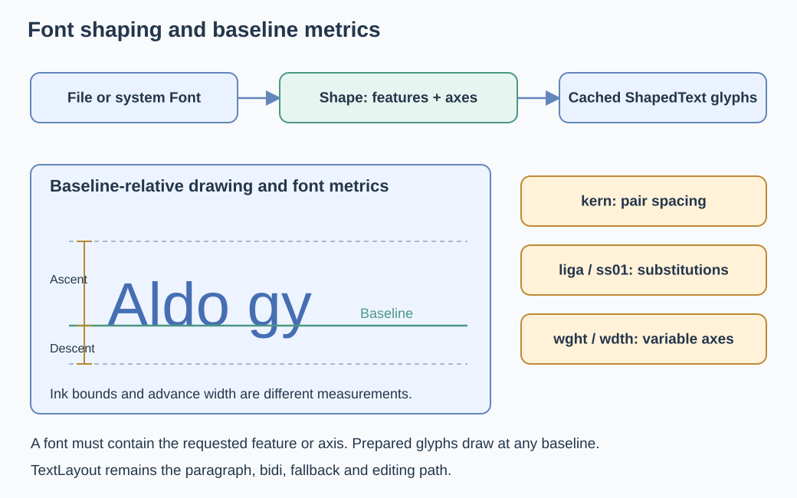

# Fonts and advanced text drawing

[Documentation index](README.md) · [Paragraph text and editing](text.md) · [Public signatures](api/reference.md)

Namespace: `Swealium.Graphics`. Font resources, glyphs, feature settings, variation coordinates and metrics use Swealium types. The public API exposes no backend objects.

## Start with DrawingContext

```csharp
using Swealium.Graphics;

// Load once and retain while widgets or drawing code need to create layouts.
using var aldo = Font.Load("Aldo.ttf");

// Inside Draw/Paint/Bitmap.Draw/VectorImage.Create:
drawing.DrawText("Free typography", new Point(20, 80), aldo, Color.White, 48,
    new TextShapingOptions { Features = [FontFeature.Kerning()] });
```

The explicit-font overload shapes **one horizontal, single-font script/direction segment** at the supplied baseline. For reusable labels/plots, prepare glyphs once outside the frame callback:

```csharp
using var title = aldo.Shape("Free typography", 48,
    new() { Features = [FontFeature.Kerning(false)], LetterSpacing = 1 });

// Reuse this immutable glyph segment across frames:
drawing.DrawShapedText(title, new(20, 80),
    Gradient.Horizontal(new(80, 200, 255), new(230, 150, 240)));
```



## Choose the appropriate text API

| Need | API |
| --- | --- |
| Existing paragraph layout, fallback, bidi, wrapping, selection, caret navigation, HTML | TextLayout / TextStyle and ordinary Text/TextBox widgets |
| File font in ordinary widgets or paragraphs | `TextStyle.Font = loadedFont` |
| Explicit OpenType features, language/script override or non-default variable axes | Font.Shape / ShapedText / DrawingContext's explicit-font overload |
| Repeated drawing without reshaping each frame | Cache ShapedText and call DrawShapedText |

The segment shaper does not perform whole-paragraph bidi reordering, wrapping, automatic font fallback or editor caret construction. It handles joining, glyph substitutions, mark positioning and kerning within the selected font/script/direction. Missing characters set HasMissingGlyphs; callers needing mixed scripts should divide text into suitable segments or use TextLayout's existing paragraph path. Newlines, tabs and Unicode line/paragraph separators are rejected by ShapedText.

**Current paragraph boundary:** the paragraph engine does not expose per-run OpenType feature overrides and does not apply variation coordinates correctly to advance widths. These controls belong to the segment path in this release. Supplying a non-default variable face to TextLayout throws NotSupportedException rather than measuring it incorrectly. Default variable instances and static faces, including static faces in a collection, work normally in paragraph widgets.

## Font loading and ownership

`Font` is a sealed IDisposable representing an immutable **face**, independently of text size. Factory methods:

| Method | Contract |
| --- | --- |
| `Load(string path, int faceIndex = 0)` | Load font bytes from a file; closes its internal file stream |
| `Load(Stream stream, int faceIndex = 0)` | Read from the current stream position; leave the caller's stream open |
| `FromBytes(ReadOnlySpan<byte> bytes, int faceIndex = 0)` | Copy encoded data; caller may immediately reuse or discard its buffer |
| `FromBase64(string base64, int faceIndex = 0)` | Decode raw Base64, then load the copied bytes |
| `Match(string? family = null, int weight = 400, FontWidth width = Normal, FontSlant slant = Upright)` | Match a system face; null uses the platform default, missing names use platform fallback |
| `GetSystemFamilies()` | Independent read-only snapshot of system family names, sorted ignoring case |

TTF, OTF and TTC loading is supported by the native font decoder; faceIndex selects the collection face and must be nonnegative. Unsupported/corrupt font data or an invalid collection selection throws InvalidDataException. Inputs are limited to 64 MiB of encoded data; the Base64 string has a corresponding pre-decode length limit. Invalid Base64 throws FormatException. Font.Load does not install a font or register its family globally: use the Font object in TextStyle or the explicit drawing overload. Embedded resources can be passed through their resource stream.

Loaded fonts own their data and backend face; widgets borrow the Font object. Dispose a font after detaching widgets that will create new layouts from it. Existing TextLayout and ShapedText objects retain internal leases and can still draw after Font.Dispose; new uses reject the disposed font. Dispose those prepared objects too. Disposal is idempotent. Face metadata remains readable after disposal; operations requiring native font access throw ObjectDisposedException. Font lease/disposal bookkeeping is synchronized; prepared layout/glyph drawing objects should not be used concurrently. The paragraph backend has its own shaping caches; Font.Dispose releases Swealium's ownership rather than purging those global caches.

## Face metadata, coverage and metrics

Read-only Font members:

| Member | Meaning |
| --- | --- |
| FamilyName | Actual selected family, which may differ from a requested missing system name |
| Weight | Face weight reported by the font, normally 1..1000 |
| Width | FontWidth class reported by the face |
| Slant | Upright, Italic or Oblique |
| GlyphCount / UnitsPerEm | Font glyph inventory size and design units per em |
| IsFixedPitch / IsDisposed | Face fixed-pitch metadata / lifetime flag |
| FeatureTags | Sorted unique GSUB/GPOS feature tags; includes kern for legacy kerning tables |
| VariationAxes | Read-only FontVariationAxis descriptions |
| Variations | Current FontVariation coordinates |

`ContainsGlyph(int codePoint)` requires a valid Unicode scalar; `ContainsGlyphs(string text)` checks nominal coverage of the supplied text. Coverage is not proof that a feature supports every script/language/character combination. FeatureTags lists font capabilities, not a promise that every tag changes every string.

`GetMetrics(float size = 16)` returns `FontMetrics(Ascent, Descent, Leading, CapHeight, XHeight)` in logical pixels. Ascent and descent are positive baseline distances. `LineHeight = max(0, Ascent + Descent + Leading)`. CapHeight/XHeight can be zero when a font does not provide them. Font metrics are not the exact visible bounds of a particular string; use ShapedText.InkBounds for that. All supplied font sizes must be finite and positive.

FontWidth values are UltraCondensed=1, ExtraCondensed, Condensed, SemiCondensed, Normal=5, SemiExpanded, Expanded, ExtraExpanded and UltraExpanded=9. Match weight must be in 1..1000 and width/slant must be defined enum values. Matching requests an available face; it does not synthesize a bold or slanted outline.

## Variable fonts

`FontVariationAxis(string Tag, float Minimum, float Default, float Maximum, bool IsHidden)` describes each native axis. `FontVariation(string Tag, float Value)` is an input/current coordinate.

```csharp
using var variable = Font.Load("MyVariableFont.ttf");
// Check VariationAxes for the available tags/ranges first.
using var heavy = variable.WithVariations([new("wght", 700)]);
using var heading = heavy.Shape("Variable font heading", 48);
drawing.DrawShapedText(heading, new(20, 80), Color.White);
```

`WithVariations(IEnumerable<FontVariation>)` creates an independently owned font face and preserves unspecified current coordinates. It accepts at most 64 settings; unknown/duplicate tags throw ArgumentException, nonfinite or out-of-range values throw ArgumentOutOfRangeException. Tags use exactly four printable ASCII characters. Static fonts report no axes and reject unknown variation requests. Selected coordinates affect both glyph shaping advances and the drawn outlines on the segment path. Paragraph layouts currently accept only default coordinates, as described above.

## OpenType features and segment options

`FontFeature(string tag, uint value = 1, int start = 0, int? end = null)` is an immutable feature setting. Tag is four printable ASCII characters, for example kern, liga, dlig, smcp, tnum, ss01 or cv01. Value 0 disables a feature, 1 enables it; some character variants accept larger values. Features unsupported by the font are ignored by shaping.

Conveniences: `FontFeature.Kerning(bool enabled = true)`, `Ligatures(bool enabled = true)`, `StylisticSet(int set, bool enabled = true)` for sets 1..20.

Start/End are a half-open **UTF-16 source range**, not glyph indices; null End means the remainder. Boundaries must be in the source string and cannot split a surrogate pair. Later settings for the same feature/range override earlier settings. Setting liga does not disable every other ligature category: clig, dlig and required script shaping have separate tags and meanings.

`TextShapingOptions` is an immutable sealed record; its feature list is copied when a segment is constructed:

| Property | Default / contract |
| --- | --- |
| Features | Empty; at most 256 validated FontFeature settings |
| Direction | Automatic: infer segment direction; explicit LeftToRight/RightToLeft overrides it |
| Language | null: shaper default; otherwise a language tag such as en, sr or ar; ASCII alphanumerics/hyphens, at most 128 characters |
| Script | null: infer; otherwise four ASCII letters such as Latn, Cyrl or Arab |
| LetterSpacing | 0; finite logical tracking, added between shaped clusters in visual order |
| Hinting | FontHinting.Normal; None, Slight and Full also available |
| SubpixelPositioning | true; retain fractional glyph positions for rendering |
| LinearMetrics | true; native glyph-font metrics preference |

Shaping advances come from OpenType design metrics and selected variation coordinates. Hinting/LinearMetrics affect native font rendering preferences and do not rerun shaping with grid-fitted advances. DrawingContext.AntiAliasing determines glyph smoothing when drawing; the cached segment can be drawn in either mode. There is no public LCD-specific rendering contract.

## ShapedText and ShapedGlyph

Construct `new ShapedText(string text, Font font, float fontSize = 16, TextShapingOptions? options = null)` or call Font.Shape with the same arguments excluding font. ShapedText is sealed, reusable, IDisposable, and does not retain a DrawingContext.

Read-only members: Text, FontSize, Options (snapshot), Direction (resolved), Glyphs, HasMissingGlyphs, Advance, Size, InkBounds, Metrics, IsDisposed. Glyphs is an immutable list of `ShapedGlyph(ushort Id, int Cluster, Point Position, Point Advance)`. Entries are in **visual glyph order**; clusters can decrease in RTL text and repeat for marks. Cluster values are UTF-16 source indices, so one ligature can represent several characters and several glyphs can share one cluster.

Position is baseline-relative and Advance is each glyph's logical pen advance, including tracking where appropriate. ShapedText.Advance is the segment's total pen vector; Size uses the absolute horizontal advance and metric line height. InkBounds is the visible glyph bounds relative to the baseline, and can extend beyond Size because of overhangs. Negative tracking can move glyphs backward; this is not an editor caret map. Empty text has zero advance/glyphs and still supplies metrics.

Dispose releases cached glyph blobs, the native glyph font and its source-font lease; repeated disposal is harmless. Immutable snapshots remain readable. Drawing a disposed segment throws ObjectDisposedException. A vector recording retains its recorded native glyph data independently from the segment's subsequent disposal.

## DrawingContext overloads

| Signature | Behavior |
| --- | --- |
| `DrawText(string text, Point baseline, Font font, Color color, float fontSize = 16, TextShapingOptions? options = null)` | Create/draw/dispose a temporary ShapedText segment |
| `MeasureText(string text, Font font, float fontSize = 16, TextShapingOptions? options = null)` | Shape and return segment Size |
| `DrawShapedText(ShapedText text, Point baseline, Color color, Rect? clip = null)` | Reuse cached glyphs; optional clip is in local drawing coordinates |
| `DrawText(string text, Point baseline, TextStyle style)` | Paragraph-engine unwrapped text at a baseline, with loaded/system style font selection |
| `MeasureText(string text, TextStyle style, TextOptions? options = null, float maxWidth = PositiveInfinity, TextMarkup markup = Plain)` | Full paragraph measurement, including wrapping and markup |

Existing color/fontSize baseline methods and rectangle/DrawTextLayout overloads remain available. Gradients work for shaped glyphs just like other drawing colors; their domain uses the segment's advance and metric line box. These operations also work in Bitmap.Draw and VectorImage.Create. Native-backed contexts enforce the same expiring frame lifetime as other drawing. External DrawingContext implementations can override the new virtual methods; DrawShapedText defaults to NotSupportedException until implemented there.

## Fonts in ordinary widgets

```csharp
var style = new TextStyle { Font = aldo, FontSize = 28, Foreground = Color.White };
var label = new Swealium.UI.Text { Content = "Aldo caption", Style = style };
var input = new Swealium.UI.TextBox { Text = "Editable Aldo", Style = style };
var button = new Swealium.UI.Button { Text = "Continue", Style = style };
```

TextStyle now has Font (default null), FontWidth (Normal), and nullable FontSlant. When Font is set, that exact face takes precedence over family/weight/width/slant requests; style color, size, spacing, decorations and paragraph controls still apply. Select another static face with Font.Match/Font.Load to change its actual outline style. No automatic faux-bold/slant is applied to a loaded face. With Font=null, the system mapper uses FontFamily, FontWeight, FontWidth, and FontSlant; null FontSlant preserves the existing Italic bool, while an explicit slant takes precedence.

Button.Style defaults to a 16-unit white TextStyle. Its existing FontSize and Foreground properties update the corresponding Style values, and style changes invalidate measurement. Text/TextBox already expose Style. HTML inherits a loaded Font by default, but explicit font-family declarations and code/pre's monospace choice clear it and return to system-family matching. CSS font-stretch keywords map to FontWidth; font-style maps to the explicit slant. HTML does not load font URLs or install fonts.

## Aldo demo and verification

Run `dotnet run --project samples/Swealium.Sample -c Release -- --font-demo`. The sample copies the supplied Aldo.ttf to build/publish output and uses it in immediate drawing, cached shaped glyphs, selectable Text, TextBox and Button. Aldo has 212 glyphs and a legacy kern table; this supplied font has no GSUB substitutions or variable axes, so enabling unsupported ligature/axis features cannot manufacture them. The demo toggles its real kerning and reports measured advances.

Tests use Aldo plus small original geometric fonts generated by `tools/generate_font_fixtures.py` to verify exact kerning, ligature, stylistic-set, language-localization, numeric-feature and variation results on every platform. The committed fixtures need no Python dependency at test runtime. CPU tests cover gradients, clips, metrics, ownership, collection faces and widget integration; `--gpu-rendering` additionally reads back a shaped glyph from a real GPU surface. Existing platform font/native-host requirements remain in [platform support](platforms.md). Font assets stay in the sample/tests; they are not included in the framework NuGet package.
