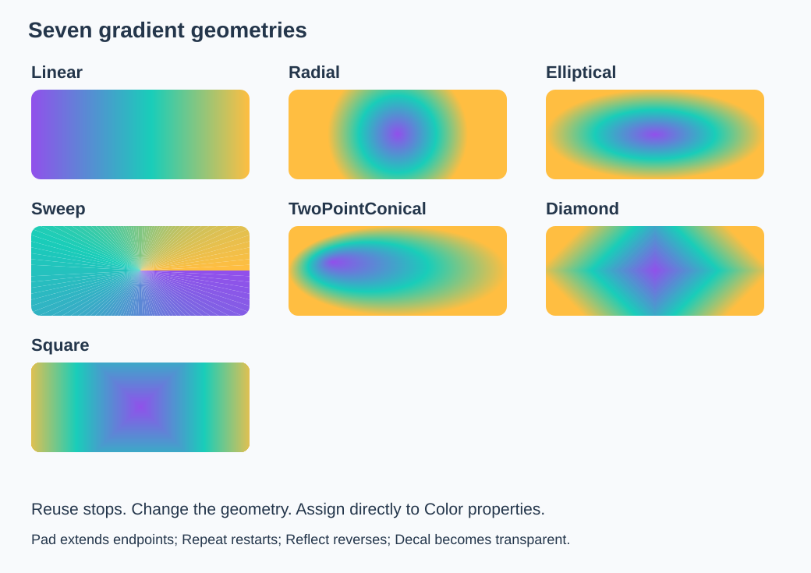

# Gradients in Color properties

[Documentation index](README.md) · [API contracts](api/gradients.md) · [Drawing](drawing.md)



Gradient converts implicitly to Color. Existing widget, window, text, scrollbar, and stroke properties accept it without new brush properties or backend objects:

```csharp
var sunset = Gradient.Horizontal(
    new Color(245, 90, 80), new Color(150, 70, 220), new Color(30, 170, 210));
var button = new Button
{
    Background = sunset,
    HoverBackground = Gradient.Vertical(Color.White, new Color(170, 215, 250)),
    TextColor = Gradient.Horizontal(Color.White, new Color(255, 225, 120)),
    Stroke = new Stroke(3, Gradient.Vertical(Color.White, new Color(110, 60, 190)))
};
```

Gradient descriptions are immutable and reusable. They own no disposable resources. Stops are copied when a factory returns; changing the source collection afterward has no effect. Set hover/pressed colors as well when a state should retain a gradient.

## Kinds and coordinate spaces

| Kind | Color progression |
| --- | --- |
| Linear | Projection from Start to End |
| Radial | Distance from center through a circular radius |
| Elliptical | Distance scaled independently by horizontal/vertical radius |
| Sweep | Clockwise angle around a center, from StartAngle to EndAngle |
| TwoPointConical | Interpolation between two circles, allowing an offset focus |
| Diamond | Sum of normalized horizontal/vertical distance from center |
| Square | Maximum of normalized horizontal/vertical distance from center |

Horizontal, Vertical, and Diagonal are evenly spaced linear presets. Other factories accept explicit ordered GradientStop values:

```csharp
GradientStop[] stops =
[
    new(0, new Color(255, 130, 80)),
    new(0.35f, new Color(180, 60, 210)),
    new(1, new Color(30, 170, 220))
];
button.Background = Gradient.Elliptical(new Point(0.5f, 0.5f), new Size(0.5f, 0.3f), stops);
button.HoverBackground = Gradient.Linear(new(0, 0), new(0.25f, 0), stops, GradientSpread.Reflect);
```

Relative units are the default. Points map to the target paint rectangle: (0,0) is its top-left and (1,1) its bottom-right. Coordinates can extend beyond those bounds. Circular radii and conical-circle radii use the shorter dimension; elliptical, diamond, and square radii use width/height independently. Absolute units use local logical coordinates and radii directly. Sweep angles are degrees, clockwise from the positive X axis; the interval must increase by at most 360 degrees.

Shapes use their drawing bounds, paths use path bounds, and widget strokes use the complete widget border box for every side. Text uses the paragraph render width and measured height, with its origin at the paragraph top-left; wrapped runs share that domain. Bitmap Clear/constructor/SetPixel use the full bitmap domain. Window backgrounds use logical client bounds and resize with the window. Bitmap pixel operations use pixel units.

## Stops, repetition, and transparency

Offsets must be ordered in [0,1]. Equal offsets form a hard transition. Missing endpoint stops extend the nearest endpoint color. At least two solid-color stops are required; nested gradients are rejected. Stop alpha participates in interpolation. Native color interpolation is in the backend's default color space; selectable color spaces are not exposed.

Spread chooses what happens beyond the gradient interval: Pad extends endpoint colors, Repeat restarts the ramp, Reflect alternates forward/backward ramps, and Decal makes it transparent. Sweep applies spread over its angular interval; its full-circle seam joins the last color to the first. Two-circle conical geometry may have no solution in some regions; those regions are transparent.

A Color holding a gradient exposes IsGradient=true and its Gradient description. R/G/B are white compatibility channels for such a value; they do not describe the varying pixels. A is a global opacity multiplier:

```csharp
Color translucent = sunset;
translucent = translucent with { A = 128 };
button.Background = translucent;
```

Solid Color construction, equality, defaults, and channels retain their existing behavior. Gradient-bearing Color equality includes the immutable description's reference identity. Deconstructing Color returns its channels; retain Gradient to inspect its stops/geometry. Changing R/G/B with a with-expression does not tint a gradient.

## Rendering coverage

Gradients work in drawing fills/lines/paths, widget state colors, per-side rounded borders, text foreground/background and selections, window backgrounds, bitmap operations, and recorded vectors. Foregrounds retain shaped glyphs, underlines, strikethrough, bidi, and wrapping. Selection and run backgrounds use the text engine's masks. Adjacent stroke sides blend their premultiplied contributions along rounded corners, including differently configured gradients. Border patterns and clipping remain independent of the color source.

CPU and GPU paths use backend-private shaders. Diamond and square use runtime shader effects; resources are retained privately for process lifetime, while draw-specific shaders are released after use. Gradient descriptions can outlive callbacks and be reused; DrawingContext lifetime rules still apply. HTML CSS parsing continues to accept solid color declarations; programmatically supplied text styles can contain gradients and survive HTML inheritance. CSS gradient syntax is not parsed.

Run the gallery with `dotnet run --project samples/Swealium.Sample -- --gradient-demo`. The headless suite checks all kinds, repetition, transparency, text, selection, strokes, and vector recording. The explicit `--gpu-rendering` test also renders each kind on a native GPU surface.
