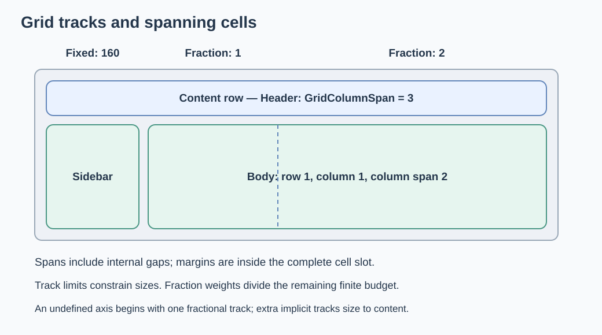

# Grid layout

[Documentation index](README.md) · [API contracts](api/grid.md) · [General layout](layout.md)

Grid is a two-dimensional Container: define row/column tracks, then place children by zero-based cell coordinates. Rendering, clipping, focus, input, and sibling ZIndex continue to use the normal visual tree.



## Define a grid

```csharp
var grid = new Grid
{
    Padding = new(20),
    RowGap = 12,
    ColumnGap = 16
};
grid.Columns.Add(new(GridLength.Fixed(160)));
grid.Columns.Add(new(GridLength.Fraction()));
grid.Columns.Add(new(GridLength.Fraction(2)));
grid.Rows.Add(new(GridLength.Content));
grid.Rows.Add(new(GridLength.Fraction()));

grid.Children.Add(new Button
{
    Text = "Header",
    GridColumnSpan = 3,
    WidthSizing = SizingMode.Fill,
    HeightSizing = SizingMode.Content
});
grid.Children.Add(new Button
{
    Text = "Main pane",
    GridRow = 1,
    GridColumn = 1,
    GridColumnSpan = 2,
    WidthSizing = SizingMode.Fill,
    HeightSizing = SizingMode.Fill
});
```

Assign grid to a window's Content, nest it in another container, or run LayoutEngine.Layout(grid, viewport) for a standalone tree. Every child defaults to row 0, column 0, row span 1, and column span 1. Placement is explicit; adding children does not automatically advance to the next free cell. Overlapping cells are allowed.

Grid overrides measurement/arrangement; its inherited Container.Layout value does not select a different algorithm. Use ordinary Container for stack/overlay/absolute layout.

## Track lengths

| Definition | Behavior |
| --- | --- |
| new GridTrack(GridLength.Fixed(120)) | Fixed logical length, subject to that track's limits |
| new GridTrack(GridLength.Content) | Intrinsic size required by children |
| new GridTrack(GridLength.Fraction()) | One weighted share of remaining finite space |
| new GridTrack(GridLength.Fraction(2)) | Two shares |
| new GridTrack() | Defaults to one fractional share |

Fixed tracks do not expand to accommodate oversized child content. Content tracks grow for measured child demand. With finite available space, fractional tracks divide the space left after fixed tracks, content tracks, and gaps, respecting track minimums and maximums.

Fraction is a ratio of the remaining track budget, not a ratio of the full grid width. Unlike stack Grow, it does not add a share to each child's intrinsic base size.

For unbounded measurement, fractional tracks act as intrinsic content tracks rather than producing infinite dimensions. This lets a grid sit inside a content-sized stack without an infinite size request.

## Placement and spanning

Set GridRow/GridColumn and GridRowSpan/GridColumnSpan on the child. A span includes intervening track sizes **and internal gaps**. Margins belong to the child and are consumed inside the complete span slot.

For intrinsic span demands, single-track demands are considered before longer spans. Nonfixed fractional tracks absorb additional spanning demand first, then content tracks. Content-only spans divide extra demand equally, up to maximums. Fixed tracks never grow. If all eligible tracks are capped, the grid retains their sizes; oversized child requirements may overflow or clip.

With finite space, a child in a fractional cell may be allocated less than its intrinsic desired size. Track MinSize reserves grid space; Widget.MinWidth/MinHeight instead constrain the child and may make it larger than its cell. These are deliberately different constraints.

## Empty axes and implicit tracks

An axis with no definitions starts with one implicit fractional track. If a visible cell or span reaches beyond defined tracks, additional implicit tracks are content-sized. Hidden children do not create implicit tracks or intrinsic demands. Explicit row/column definitions remain present even when empty.

For example, a child at row 2 creates rows 0–2 when Rows is empty: row 0 is fractional, rows 1 and 2 are content-sized. Empty tracks can still have surrounding gaps. Define tracks explicitly when equal rows/columns are required.

RowSizes and ColumnSizes are read-only snapshots from the last arrangement and include implicit tracks. Explicit definitions also expose ActualSize. Snapshots do not change after you store them; query again after layout.

## Spacing and alignment

Grid inherits Padding, Margin, Gap, Radii, Background, and ClipToBounds. RowGap/ColumnGap are nullable overrides; null inherits Gap.

Both content alignments default to Stretch in a Grid, so legacy automatic child dimensions fill their cells. Child WidthSizing/HeightSizing=Content opts out of stretching; Fill occupies the cell slot regardless of its alignment, up to child limits.

HorizontalContentAlignment/VerticalContentAlignment provide per-child defaults and position the entire track group when fixed/content/capped tracks leave unused room. Per-child alignment overrides positioning inside its cell/span. Explicit numeric dimensions remain fixed unless the chosen sizing mode clears them. Stack Grow and X/Y offsets do not determine grid placement.

## Track constraints

```csharp
var sidebar = new GridTrack(GridLength.Fraction())
{
    MinSize = 120,
    MaxSize = 280
};
grid.Columns.Add(sidebar);
```

Minimums and maximums are nonnegative; maximums can be positive infinity. If MinSize exceeds MaxSize, the minimum wins, consistent with widgets.

A fractional track reaching its maximum releases the remaining budget to other fractional tracks. Minimums can force the total beyond the available size; tracks are not reduced below their minimum. The remaining fractional budget can be zero if fixed/content tracks already consume the available area.

## Content versus fill grids

For a grid that fills width but sizes its height from content:

```csharp
grid.WidthSizing = SizingMode.Fill;
grid.HeightSizing = SizingMode.Content;
```

Use content rows for form-like layouts. Content sizing first computes intrinsic track demand; width is then bounded by available constraints and cells are remeasured at that width so width-dependent heights are updated. A finite MaxWidth therefore causes a content-sized grid to remeasure wrapping custom widgets before reporting height.

Button uses unwrapped shaped text. Text and multiline TextBox provide width-dependent wrapping and measurement inside grid cells; custom widgets may also return width-dependent heights from MeasureContent.

## Dynamic changes and nesting

Changing definitions, track lengths/limits, gaps, placement/spans, visibility, child collections, or child intrinsic properties invalidates ancestor layout. Grids can nest, and input hit testing reruns a known root's invalidated layout before selecting a cell child.

The solver performs bounded repeated measurement because content columns can change the width available to a fractional column, which can change content-row height. Custom MeasureContent implementations must be stable for stable constraints. Failure to converge after 32 passes raises InvalidOperationException instead of looping forever.

Track objects belong to one row/column collection. Remove a track before reusing it on another axis/grid. Removing a definition resets its ActualSize; snapshots remain last-arranged data until layout runs again.

## Rendering and interaction

Cells are layout slots, not separate widgets. An empty cell or gap can hit the grid itself. A spanning child can cover internal gaps. Higher sibling ZIndex draws/hit-tests in front regardless of row/column coordinates.

There is no extra automatic per-cell clipping layer: normal child bounds and ancestor ClipToBounds apply. A child with an explicit/minimum size larger than its cell may overlap a neighbor; use sizing/track constraints to avoid it. Rounded grid boundaries clip the entire grid subtree as usual.

Grid supplies explicit track layout, not scrolling, virtualization, automatic sequential placement, shared-size groups, percentage tracks, or draggable splitters.

