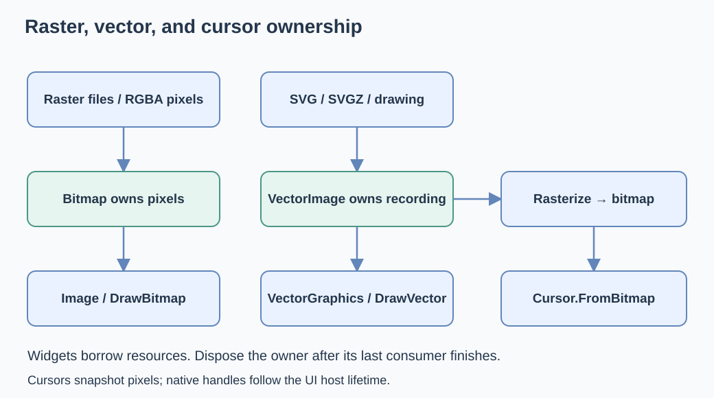

# Bitmaps, images, and vectors

[Documentation index](README.md) · [Media API contracts](api/media.md) · [Image widget](widgets/image.md) · [VectorGraphics widget](widgets/vector-graphics.md)



## Load and display raster images

```csharp
using Swealium.Graphics;
using Swealium.UI;

using var photo = Bitmap.Load("photo.jpg");
SwealiumApplication.Run(configure: window =>
{
    window.Content = new Image
    {
        Source = photo,
        Stretch = ImageStretch.Uniform,
        Padding = new(20)
    };
});
```

Bitmap owns its decoded 8-bit RGBA pixels and implements IDisposable. File, stream, and byte-span loading detect the format from content rather than the extension. Streams stay open, positioned after the bytes read. Keep resources alive until all widgets/drawing consumers are finished. Assigning or removing Source does not dispose it, so several widgets can share one resource. Decode in a worker if needed, then assign widget properties on the UI thread; do not concurrently mutate/draw/dispose the same resource.

### Format coverage

| Input | Behavior |
| --- | --- |
| PNG, JPEG/JPG, WebP, GIF, BMP, ICO, WBMP | Native Skia codecs; first/default image frame |
| TGA, PSD, Radiance HDR, Softimage PIC | Portable decoder fallback; rasterized to 8-bit RGBA |
| PBM, PGM, PPM / Netpbm | P1–P6, ASCII comments, packed binary PBM, 8/16-bit binary samples, sample scaling |
| SVG, SVGZ | Load with VectorImage; use Rasterize for a bitmap |
| Other native codecs | Accepted if present in the deployed native library; no guarantee for AVIF/HEIF/RAW across platforms |

GIF/WebP animation timelines, multipage document selection, and PSD layer editing are not provided. JPEG EXIF orientations are applied, including rotations and mirrors. HDR and 16-bit sources convert to the current 8-bit raster pipeline. TIFF, DDS, PDF, and video are not advertised decoders. Supported PNG/JPEG/WebP encoders are exposed through BitmapFormat; output format is explicit, not inferred from filename.

Automated fixtures exercise PNG/JPEG/WebP round trips plus GIF/BMP/ICO/WBMP/TGA/PSD/HDR/PNM decoding. PIC is provided by the fallback dependency and has no repository fixture yet. Real-world variants still depend on codec support.

ImageLoadOptions defaults to at most 64 MiB encoded input and 64 million decoded pixels. Pass a validated options record to tighten/adjust those limits. Oversized, empty, malformed, or unsupported input raises InvalidDataException. There are no implicit network downloads.

## DrawBitmap and pixel editing

```csharp
using var bitmap = new Bitmap(120, 80, Color.Transparent);
bitmap.Draw(drawing =>
{
    drawing.FillRectangle(new Rect(0, 0, 120, 80), new Color(30, 70, 130));
    drawing.FillEllipse(new Rect(30, 10, 60, 60), Color.White);
});
bitmap.SetPixel(0, 0, new Color(255, 0, 0));
byte[] rgba = bitmap.CopyPixels(); // tightly packed, unpremultiplied R/G/B/A
bitmap.Save("icon.png");

// Inside Widget.Draw or window.Paint:
drawing.DrawBitmap(bitmap, new Rect(20, 20, 240, 160));
drawing.DrawBitmap(bitmap, new Rect(280, 20, 80, 80),
    source: new Rect(30, 10, 60, 60), opacity: 0.7f,
    interpolation: BitmapInterpolation.Cubic);
```

GetPixel/SetPixel use integer pixel coordinates; drawing coordinates remain logical units. Clone and CopyPixels return independent copies. FromPixels takes exact tightly packed straight-alpha RGBA. Bitmap.Draw supplies an expiring Swealium DrawingContext backed by the owned raster surface. It rejects reentry and disposal inside its callback; callback exceptions still invalidate the context and update the image snapshot. Saving/writing streams leaves them open. Use PNG for lossless alpha; JPEG has no alpha channel.

DrawBitmap accepts destination, optional source crop, opacity [0,1], interpolation (Nearest/Linear/Cubic), and an optional local clip. The Point overload draws at natural pixel dimensions in logical units. Source rectangles must lie inside the bitmap. Zero extents/zero opacity draw nothing, while frame/resource validation still applies. Custom DrawingContext subclasses may override these new virtual methods; the base implementations throw NotSupportedException.

## Layout and scaling

Image and VectorGraphics share four stretch policies:

| ImageStretch | Display |
| --- | --- |
| None | Natural size |
| Fill | Independent X/Y scaling to content bounds |
| Uniform | Fit while preserving aspect ratio; may letterbox |
| UniformToFill | Cover while preserving aspect ratio; overflow clipped to content bounds |

HorizontalContentAlignment/VerticalContentAlignment default to Center. Start/End align within the content area; Stretch has Start positioning because the Stretch property controls scaling. Padding remains clear, including cover scaling. With constrained width and automatic height, aspect-preserving measurement computes the corresponding height; fully unbounded measurement uses natural dimensions. Cover uses bounded aspect-preserving measurement, then crops while drawing. Inherited Radii, Stroke, layout placement, visibility, and input work normally.

## SVG and recorded vectors

```csharp
using var icon = VectorImage.Parse("""
    <svg xmlns="http://www.w3.org/2000/svg" width="100" height="60">
      <rect width="100" height="60" rx="12" fill="#315b91"/>
      <path d="M20 30 L43 48 L80 12" fill="none" stroke="white" stroke-width="8"/>
    </svg>
    """);
var widget = new VectorGraphics { Source = icon, Width = 200, Height = 120 };
```

VectorImage.Load accepts SVG/SVGZ files/streams. Parse accepts SVG text. Geometry, paths, transforms, gradients, masks/clips, supported static filters/CSS/text, local definitions, and embedded data images are handled by the internal SVG renderer. This is static SVG rendering, not a browser, script engine, interactive DOM, or animation timeline. DTD/entities and external file/network resources are disabled. Missing/blocked resources may display a renderer placeholder; embedded data and local references remain available. SVG fonts depend on installed font coverage.

```csharp
using var path = VectorPath.Parse("M10 10 L80 10 L45 60 Z");
using var vector = VectorImage.Create(new Rect(0, 0, 100, 80), drawing =>
{
    drawing.FillPath(path, new Color(80, 130, 210));
    drawing.StrokePath(path, Color.White, 3, PathLineCap.Round, PathLineJoin.Round);
});
using var raster = vector.Rasterize(300, 240);
```

VectorPath also supports MoveTo/LineTo/QuadraticTo/CubicTo/ArcTo/Close, rectangles, ellipses, Clear, Bounds, and Contains. FillRule chooses Winding or EvenOdd. Drawing takes a path snapshot, so later edits do not rewrite a recorded VectorImage. Dispose paths/recordings when finished. DrawVector scales a recording to a destination with optional opacity and clipping; nonzero viewBox origins are handled. Rasterize produces an owned bitmap, useful for export or a [custom cursor](cursors.md).

Run `dotnet run --project samples/Swealium.Sample -- --media-demo` for the combined bitmap, vector, and cursor example. It displays the sample's cat.png, copied alongside the executable for both build and publish, and includes VSplit/HSplit cursor previews.
