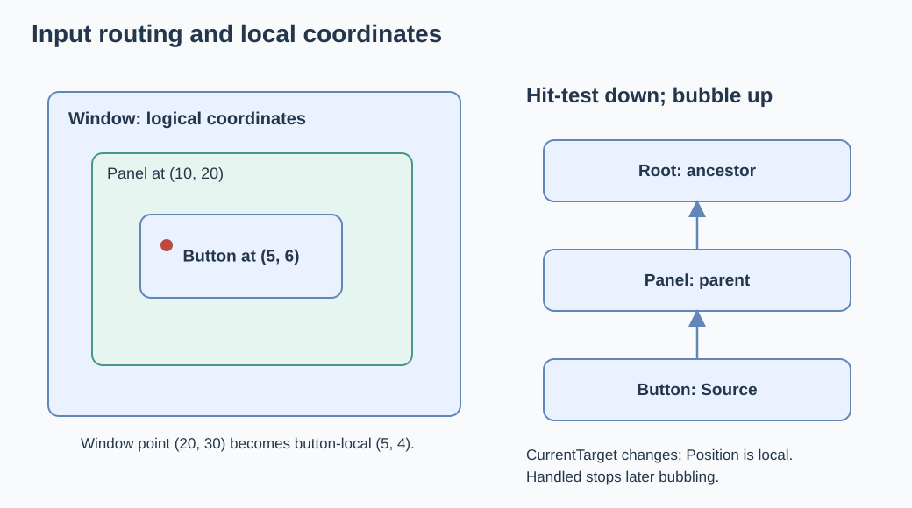

# Pointer, keyboard, and text input

[Documentation index](README.md) · [API contracts](api/input.md)



## Hit testing

InputManager.HitTest takes logical window coordinates. It visits topmost eligible children first using ZIndex and reverse insertion order for ties. Hidden, disabled, or IsHitTestVisible=false subtrees are skipped. Rounded cut-outs are excluded analytically using the same normalized radii as drawing.

With ClipToBounds=true a parent's rounded boundary also clips descendant input. With false the search can reach overflowing children. For overlapping independent windows, native event routing determines the target window before widget hit testing.

## Routing and coordinates

PointerInput, KeyboardInput, and TextInput bubble from Source through parents. CurrentTarget changes as the event is delivered. Pointer Position is recomputed in CurrentTarget's local coordinates; WindowPosition stays unchanged. Set Handled to stop subsequent bubbling.

```csharp
button.PointerInput += e =>
{
    if (e.Kind == PointerEventKind.Down)
    {
        Console.WriteLine($"Local: {e.Position}; window: {e.WindowPosition}");
        e.Handled = true;
    }
};
```

Widget virtual input hooks run before that widget's public event subscription. Stopping bubbling does not undo work already performed by a control's hook. Pointer Enter/Leave notifications are delivered directly to the affected widgets, not through the bubbling route.

## Capture and clicks

Primary Down captures the hit widget automatically and focuses the nearest focusable ancestor. Further motion/up reaches the captured target even outside its bounds. Primary Up releases capture. A click is synthesized only when release hits the same original target, input remains unhandled, and the widget remains attached/enabled/visible.

Moving off the shape clears hover/pressed appearance while capture remains active. Releasing in a rounded cut-out does not click. Other buttons do not synthesize PerformClick. There is no public manual capture API yet.

Capture, hover, and focus are canceled after deactivation, hiding, minimizing, root replacement, or loss of attachment/eligibility. A mouse leave clears hover without releasing active capture. Stationary hover is recalculated during input validation after layout, z-order, or radii changes.

## Focus and keyboard activation

Use Tab / Shift+Tab for insertion-order depth-first navigation. ZIndex does not change traversal. A widget must be attached, visible, enabled, and IsFocusable to be focused. IsHitTestVisible controls pointer hit testing rather than keyboard eligibility.

```csharp
bool accepted = window.Input.Focus(button);
window.Input.Focus(null); // clear widget focus
```

Window HasFocus is OS keyboard focus. Widget IsFocused is focus within that window. They are separate concepts.

Button activates on release of Space or Enter after a matching non-repeat press. Repeats do not trigger extra clicks. Focus loss cancels pending keyboard activation. An unhandled non-repeat Tab is consumed by default navigation after focused-widget key routing.

## Characters are not keys

Key identifies a limited set of physical keys independently of keyboard layout. KeyModifiers describes modifiers. Use TextInput for actual Unicode characters:

```csharp
widget.IsFocusable = true;
widget.AcceptsTextInput = true;
widget.TextInput += e => Console.WriteLine(e.Text);
window.Input.Focus(widget);
```

Native text input starts when a focused widget opts in and stops when that focus is removed. The API handles committed UTF-8 text, copied before the next native poll. It does not yet expose IME preedit/candidate updates or a built-in text editor.

## Synthetic input and hosts

ProcessPointer, ProcessKey, and ProcessText accept Swealium-owned event objects. Use a fresh event per dispatch because routing mutates Handled, Source, CurrentTarget, and local Position. Configure Root and arrange the tree first in a standalone host. Run already owns event dispatch; do not run another SDL poll loop alongside it.

A window's InputManager rejects synthetic input while its window is hidden, minimized, closing, disposed, or blocked by a modal dialog. A standalone InputManager has no window policy. All processing and tree mutation should run on the UI thread.

