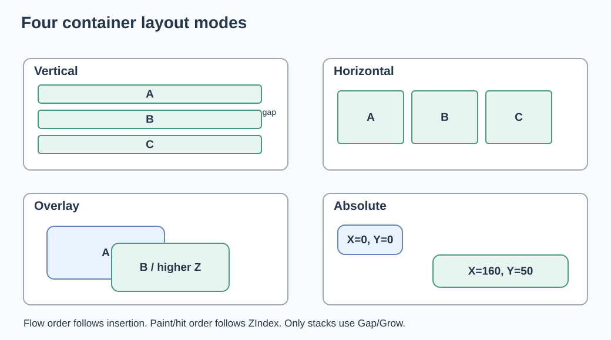

# Layout and the box model

[Documentation index](README.md) · [Widget contracts](api/widgets.md)


## The two passes

Measure computes DesiredSize, including margins. Arrange assigns Bounds relative to the parent. Draw uses ActualWidth/ActualHeight, which exclude margins and include padding. Width/Height remain requests; float.NaN means automatic content size. The window's root is allocated its viewport without overwriting those requests, subject to margins and min/max bounds.

Built-in containers call child Measure/Arrange for you. A window reruns layout when invalidated or resized. Standalone trees should call LayoutEngine.Layout(root, viewport) before hit testing/drawing.

Padding belongs inside the widget. Margin belongs outside it. Gap separates visible children's margin boxes in a stack. Thickness uses left, top, right, bottom order; two arguments mean horizontal and vertical; one means uniform. Spacing is finite and nonnegative.

## Select a layout mode



| Mode | Measurement | Arrangement |
| --- | --- | --- |
| Vertical, default | Max child width; sum heights and gaps | Children advance downward in insertion order |
| Horizontal | Sum widths and gaps; max height | Children advance rightward in insertion order |
| Overlay | Max child extents | Each child shares the content area |
| Absolute | Max X/Y plus desired extent | X/Y offset each child's slot from the padded origin |

Stacks measure with unbounded space on their main axis and available space on the cross axis. They do not wrap. Hidden children contribute neither space nor gaps; disabled children keep their space.

Gap and Grow do not affect Overlay/Absolute. X/Y only affect Absolute. For overlap use Overlay or Absolute plus ZIndex, rather than negative margins.

## Align content and place one child

```csharp
var column = new Container
{
    Padding = new(20),
    Gap = 12,
    HorizontalContentAlignment = Alignment.Center,
    VerticalContentAlignment = Alignment.Center,
    Children =
    {
        new Button { Text = "Centered" },
        new Button { Text = "At the end", HorizontalAlignment = Alignment.End }
    }
};
```

Container content alignment provides defaults. Nullable HorizontalAlignment/VerticalAlignment on a child override those defaults. Default container values are horizontal Stretch and vertical Start.

Start, Center, and End position a widget inside its allocated slot. Stretch fills an **automatic** dimension; explicit Width/Height stay fixed except when expanded by Grow. On a stack's main axis, content alignment moves the entire group. Individual main-axis alignment operates within a child's assigned slot, so it does not independently move that child to another part of the stack.

When content exceeds available space, alignment offsets stop at zero rather than pushing oversized children farther negative. ClipToBounds controls whether overflow is clipped; no scrolling is added automatically.

## Share spare space

```csharp
var row = new Container { Layout = LayoutMode.Horizontal, Gap = 8 };
row.Children.Add(new Button { Text = "One share", Grow = 1 });
row.Children.Add(new Button { Text = "Two shares", Grow = 2, MaxWidth = 500 });
```

Grow divides **spare** main-axis space after measured sizes, margins, and gaps. It adds space to each child's base size, so 1:2 weights do not necessarily create total widths in a 1:2 ratio. Maximums cap growth; unused shares are redistributed among remaining eligible children. Grow never shrinks oversized content when space is insufficient.

MinWidth/MinHeight and MaxWidth/MaxHeight constrain both measurement and arrangement. Max defaults to positive infinity; min defaults to zero. If min exceeds max, min wins. Width/Height may be NaN, but finite explicit values cannot be negative or infinite.

## Z-order and clipping

ZIndex affects rendering/hit testing among siblings, not stack order or keyboard traversal. Larger values are in front. Equal values use insertion order, with later children in front.

Radii defines the widget's rounded boundary. With ClipToBounds=true, rendering and descendant input are clipped to it. With false, children may overflow both its rectangle and rounded cut-outs, subject to ancestor clipping.

## Invalidation

Changing layout properties, button text/font size, visibility, or a child collection invalidates ancestor layout. Custom intrinsic measurement data must call InvalidateLayout. IsLayoutValid reports whether that widget has been arranged and remains clean. Direct public measurement/arrangement calls are advanced APIs; use LayoutEngine for normal standalone roots.

Read [custom widgets](custom-widgets.md) for implementing intrinsic size and custom container arrangement.

