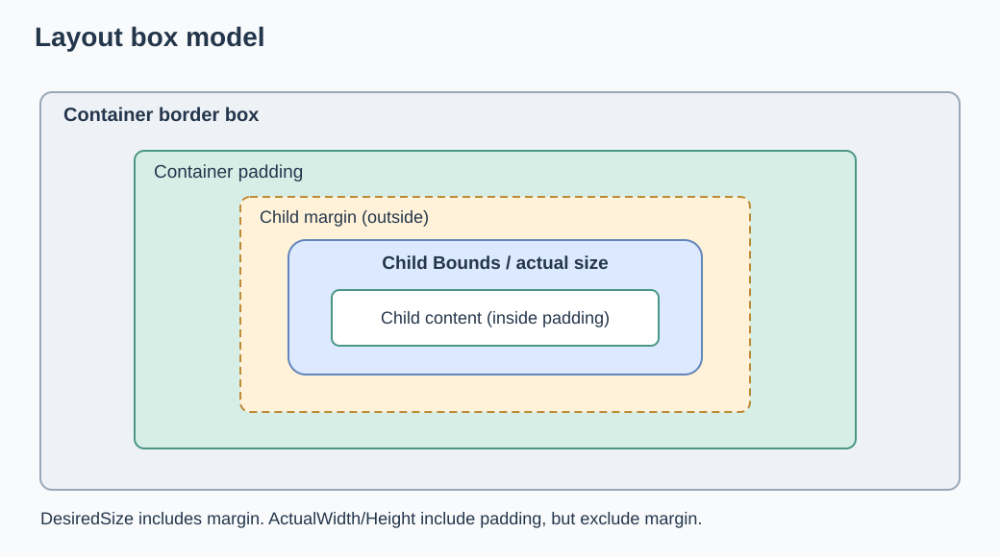
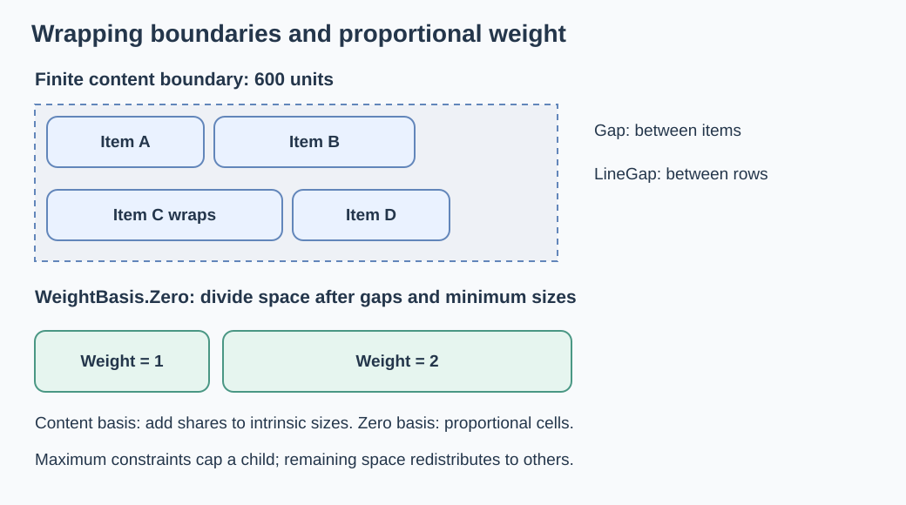

# Layout and the box model

[Documentation index](README.md) · [Widget contracts](api/widgets.md)



## The two passes

Measure computes DesiredSize, including margins. Arrange assigns Bounds relative to the parent. Draw uses ActualWidth/ActualHeight, which exclude margins and include padding. Width/Height remain requests; float.NaN means automatic content size. The window's root is allocated its viewport without overwriting those requests, subject to margins and min/max bounds.

## Content size and parent fill

Use named axis modes without special numeric sizes:

```csharp
var button = new Button
{
    Text = "Full width, content height",
    WidthSizing = SizingMode.Fill,
    HeightSizing = SizingMode.Content
};
```

SizingMode.Content uses the intrinsic desired size and opts out of inherited Stretch. SizingMode.Fill takes the padded parent slot minus the child's margins, subject to min/max constraints, regardless of alignment. Under unbounded measurement Fill falls back to finite intrinsic content size.

SizingMode.Automatic is the compatibility default: numeric Width/Height stay fixed, and NaN follows the existing content/alignment behavior. Setting Content/Fill clears that axis's numeric request to NaN. Assigning Width/Height afterward, including NaN, returns that axis to Automatic. Initializer order therefore matters: the last sizing assignment wins.

Fill and Grow differ: Fill on a stack's main axis takes the **entire parent content extent** for each fill child, so siblings may overflow; Grow divides only the spare space among siblings. Use Grid fractional tracks or stack Grow when children should share space. Grow's allocated main-axis size and the window root's viewport allocation can override Content sizing.

Sizing affects dimensions, while alignment positions the result. A max-constrained Fill child can still be centered/end-aligned inside its slot.

Built-in containers call child Measure/Arrange for you. A window reruns layout when invalidated or resized. Standalone trees should call LayoutEngine.Layout(root, viewport) before hit testing/drawing.

Padding belongs inside the widget. Margin belongs outside it. Gap separates visible children's margin boxes in a stack. Thickness uses left, top, right, bottom order; two arguments mean horizontal and vertical; one means uniform. Spacing is finite and nonnegative.

## Select a layout mode


| Mode | Measurement | Arrangement |
| --- | --- | --- |
| Vertical, default | Max child width; sum heights and gaps | Children advance downward in insertion order |
| Horizontal | Sum widths and gaps; max height | Children advance rightward in insertion order |
| Overlay | Max child extents | Each child shares the content area |
| Absolute | Max X/Y plus desired extent | X/Y offset each child's slot from the padded origin |

Stacks measure with unbounded space on their main axis and available space on the cross axis. They do not wrap. Hidden children contribute neither space nor gaps; disabled children keep their space.

For wrapping use `WrapContainer`, described below. Weighted stack children are remeasured at their allocated finite main-axis size so text wrapping can update the cross-axis height.

## Wrapping at a boundary



```csharp
var flow = new WrapContainer { Gap = 8, LineGap = 12, Padding = new(16) };
foreach (string caption in new[] { "One", "Another item", "Three", "Four" })
    flow.Children.Add(new Button { Text = caption });
root.Children.Add(flow);
```

Direction defaults to Horizontal: items occupy a row until adding an item and its gap would exceed available content width. The next item begins a row. Vertical flows down columns and wraps at available content height. An oversized item occupies its own line and can overflow according to ordinary clipping. An unbounded main axis makes one line. Padding reduces the boundary; margins participate in item lengths. Equal-to-boundary items fit (within a small floating-point tolerance).

`Gap` separates items; nullable `LineGap` separates rows/columns and defaults to Gap. Hidden children consume neither gaps nor lines. Insertion order controls flow; ZIndex only affects painting/hit testing. Content alignment positions the group of lines and each line's items; inherited cross-axis alignment applies within a line. `LineCount` and read-only `Lines` report the last arrangement in local coordinates. Use Direction on WrapContainer; its inherited Layout property does not control wrapping.

## Proportional weight

`Weight` is an alias of the existing `Grow` property. A positive weight participates in spare-space allocation along a stack's main axis, or separately within each wrap line. It is finite and nonnegative; zero does not participate. WeightBasis defaults to Content, which adds a weighted share to measured content. WeightBasis.Zero starts from the minimum dimension plus margins, making equal weights equal size when minimum/maximum constraints are equal, regardless of caption length.

```csharp
var row = new Container { Layout = LayoutMode.Horizontal, Gap = 10 };
row.Children.Add(new Button { Text = "1 share", Weight = 1, WeightBasis = WeightBasis.Zero });
row.Children.Add(new Button { Text = "2 shares", Weight = 2, WeightBasis = WeightBasis.Zero });
// At 310 units wide: after the gap, 100 and 200 units.
```

The allocator subtracts bases, margins, and gaps, then distributes positive remaining space by relative weights. Capped children stop at MaxWidth/MaxHeight and leftover space redistributes. There is no negative-space shrinking; oversized content may overflow. With an unbounded main axis, weight does not expand and Zero falls back to intrinsic content. Overlay, absolute layout, and Grid do not apply widget weights; Grid has fractional tracks instead.

Wrap boundaries are determined from intrinsic bases before per-line expansion. Zero-basis items may share a line regardless of their caption's natural width; set minimum sizes to establish useful wrap boundaries. Weighted children are remeasured at allocated lengths before determining line cross sizes.

Gap and Grow do not affect Overlay/Absolute. X/Y only affect Absolute. For overlap use Overlay or Absolute plus ZIndex, rather than negative margins.

For two-dimensional rows, columns, and spans, use [Grid](grid.md), a separate Container subclass. Its inherited Layout property does not switch away from grid arrangement.

## Align content and place one child

```csharp
var column = new Container
{
    Padding = new(20),
    Gap = 12,
    HorizontalContentAlignment = Alignment.Center,
    VerticalContentAlignment = Alignment.Center,
    Children =
    {
        new Button { Text = "Centered" },
        new Button { Text = "At the end", HorizontalAlignment = Alignment.End }
    }
};
```

Container content alignment provides defaults. Nullable HorizontalAlignment/VerticalAlignment on a child override those defaults. Default container values are horizontal Stretch and vertical Start.

Start, Center, and End position a widget inside its allocated slot. Stretch fills an **automatic** dimension; explicit Width/Height stay fixed except when expanded by Grow. On a stack's main axis, content alignment moves the entire group. Individual main-axis alignment operates within a child's assigned slot, so it does not independently move that child to another part of the stack.

Explicit Content sizing opts out of Stretch; explicit Fill sizing fills even when the alignment is Start/Center/End, with min/max limits still applied.

When content exceeds available space, alignment offsets stop at zero rather than pushing oversized children farther negative. ClipToBounds controls whether overflow is clipped; no scrolling is added automatically.

## Share spare space

```csharp
var row = new Container { Layout = LayoutMode.Horizontal, Gap = 8 };
row.Children.Add(new Button { Text = "One share", Grow = 1 });
row.Children.Add(new Button { Text = "Two shares", Grow = 2, MaxWidth = 500 });
```

Grow divides **spare** main-axis space after measured sizes, margins, and gaps. It adds space to each child's base size, so 1:2 weights do not necessarily create total widths in a 1:2 ratio. Maximums cap growth; unused shares are redistributed among remaining eligible children. Grow never shrinks oversized content when space is insufficient.

MinWidth/MinHeight and MaxWidth/MaxHeight constrain both measurement and arrangement. Max defaults to positive infinity; min defaults to zero. If min exceeds max, min wins. Width/Height may be NaN, but finite explicit values cannot be negative or infinite.

## Z-order and clipping

ZIndex affects rendering/hit testing among siblings, not stack order or keyboard traversal. Larger values are in front. Equal values use insertion order, with later children in front.

Radii defines the widget's rounded boundary. With ClipToBounds=true, rendering and descendant input are clipped to it. With false, children may overflow both its rectangle and rounded cut-outs, subject to ancestor clipping.

## Invalidation

Changing layout properties, button text/font size, visibility, or a child collection invalidates ancestor layout. Custom intrinsic measurement data must call InvalidateLayout. IsLayoutValid reports whether that widget has been arranged and remains clean. Direct public measurement/arrangement calls are advanced APIs; use LayoutEngine for normal standalone roots.

Measurement also reuses results for identical constraints until invalidated. Custom widgets must call InvalidateLayout when intrinsic data changes; do not rely on MeasureContent being invoked on every pass.

Read [custom widgets](custom-widgets.md) for implementing intrinsic size and custom container arrangement.

