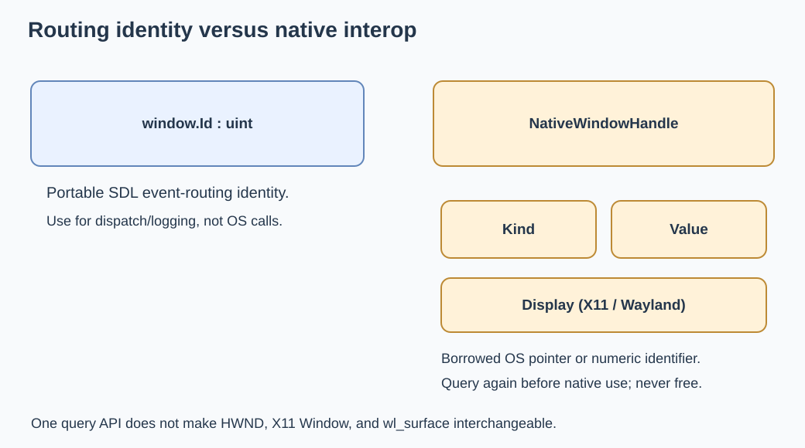

# Portable IDs and native window handles

[Documentation index](README.md) · [Windowing API](api/windowing.md)



## Two different identities

window.Id already returns a platform-independent uint assigned by SDL for event routing. It identifies the window in Swealium's application registry/native event stream. It is not an HWND, X11 Window, process ID, serialized application identity, or SDL_Window pointer. Do not pass it to OS APIs expecting those handles.

For platform integration, the same public methods work across supported backends:

```csharp
Console.WriteLine($"Portable routing ID: {window.Id}");

if (window.TryGetNativeWindowHandle(out NativeWindowHandle handle))
{
    Console.WriteLine($"System: {handle.Kind}; value: 0x{handle.Value:X}");
    Console.WriteLine($"Display connection: 0x{handle.Display:X}");
}
else
{
    Console.WriteLine("This backend exposes no supported OS window handle.");
}
```

GetNativeWindowHandle is the throwing form. Both enforce live-window/UI-thread access. Try returns false and a default descriptor for unavailable/unsupported native systems, not for incorrect thread/disposal usage.

## Descriptor mapping

| Kind | Value | Display |
| --- | --- | --- |
| Win32 | HWND | Zero |
| Cocoa | NSWindow pointer | Zero |
| UIKit | UIWindow pointer | Zero |
| Android | ANativeWindow pointer | Zero |
| X11 | Numeric X11 Window identifier, not a pointer | Display pointer when available |
| Wayland | wl_surface pointer | wl_display pointer when available |
| None | Zero, invalid | Zero |

The lookup uses SDL's exposed native properties, not the managed runtime's OS name. That distinction matters on Linux, where X11 and Wayland use different native objects. It also avoids mistaking a headless/dummy backend for a real Windows or Linux desktop window.

The descriptor's IsValid checks non-None kind and nonzero value. It is not a native liveness test. A caller can construct a descriptor manually; that does not create or validate an OS object.

## Borrowed lifetime

The window/SDL owns every returned pointer/identifier and connection. Do not destroy, free, close, retain/release, or transfer ownership of them. Query immediately before an interop operation. Requery after show/hide, surface recreation, or other relevant native lifecycle transitions; never use a cached descriptor after disposal.

The descriptor is a value snapshot and cannot automatically invalidate copies when the window dies. IsValid on an old copy can remain true after its native object has disappeared.

Do not mutate the native window hierarchy, destroy the OS window, or take over its event/render loop behind Swealium. Doing so bypasses framework ownership and can invalidate renderer resources or dispatch assumptions.

## What portability does and does not mean

The query API and result shape are portable. The meaning of the raw value is necessarily platform-specific: branch on Kind before calling a native SDK. No generic integer can be passed to all OS window APIs with identical semantics.

No raw SDL_Window pointer or Skia object is exposed publicly. X11's numeric identifier uses nuint to preserve the active process architecture's native width. Display is a borrowed pointer, not a managed object.

The headless suite tests mappings for all supported descriptor kinds using synthetic property bags. A real Windows query is checked by the native-window-controls test. Cocoa/UIKit/Android/X11/Wayland integration still requires runtime verification on those environments. Providing handle mappings does not implement the missing iOS/Android application hosts.

Upstream definitions: [portable SDL window IDs](https://wiki.libsdl.org/SDL3/SDL_GetWindowID), [native window properties and backend lifetimes](https://wiki.libsdl.org/SDL3/SDL_GetWindowProperties).

