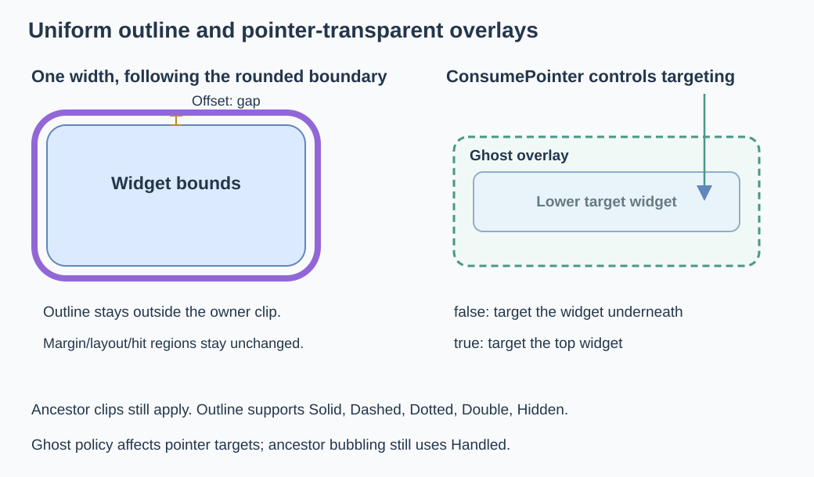

# Pointer consumption and widget outlines

[Documentation index](README.md) · [Widget](widgets/widget.md) · [Input](input.md) · [Graphics contracts](api/graphics.md)



## ConsumePointer

Widget already has IsHitTestVisible. ConsumePointer exposes the same flag with the requested name; both default true and changing either updates the other.

```csharp
overlay.ConsumePointer = false; // Draw it, but target widgets underneath.
overlay.ConsumePointer = true;  // It becomes the pointer target within its shape.
```

True prevents hit testing from continuing to siblings behind a widget. Normal source-to-parent input bubbling remains available; set an event's Handled flag to stop ancestor routing. This preserves scrolling and container handlers. A rounded widget only consumes inside its actual rounded hit shape, and transforms keep hit testing aligned with drawing.

False makes the widget and its entire subtree ghosts for pointer targeting, including hover, clicks, wheel targeting, and automatic/manual capture. The next input/frame validation cancels an existing capture and sends cleanup Cancel/Leave notifications. Draw/layout behavior is unchanged. Keyboard focus/text input and accessibility semantics remain independently controlled; use IsFocusable/AcceptsTextInput or Accessibility.IsHidden if those should also change. Setting a container false ghosts its children even if their own flags are true.

## Uniform outline

```csharp
widget.Outline = new Outline(
    width: 3,
    color: new Color(90, 170, 240),
    style: StrokeStyle.Dashed,
    offset: 4);
```

Outline is an immutable Swealium.Graphics value with one Color, Width, Style, and Offset. Constructor `(float width, Color color, StrokeStyle style=Solid, float offset=0)` validates finite nonnegative width, finite signed offset, and a defined StrokeStyle; invalid values throw ArgumentOutOfRangeException. Default Outline has Width=0, transparent Color, Solid style, and Offset=0, so it draws nothing. Assign default to remove an outline.

Width is uniform around all four edges. Positive Offset leaves that many logical units between the widget boundary and outline's inner edge. Zero places the inner edge against the boundary; a negative value moves it inside. Very negative offsets that collapse the expanded geometry paint nothing. Resolved geometry that exceeds drawable coordinates throws InvalidOperationException.

Styles reuse StrokeStyle: Solid, Dashed, Dotted, Double, Hidden. Double paints the outer/inner thirds with a clear middle. Dashed/dotted patterns follow rounded geometry. Hidden or zero width paints nothing. Color accepts solid colors or gradients. Gradient coordinates cover the outline's outer box.

Outline follows Widget.Radii, expanding rounded corners for the gap/width while retaining sharp corners where radius is zero. It paints after the widget's contents, descendants, overlays, and stroke. The widget's own ClipToBounds does not cut off its external outline. Ancestor rounded clips, scroll viewports, and the window surface still clip it. Widget transforms and group Opacity apply to the outline with the rest of the visual.

Outlines are decorative: they do not enlarge Bounds, DesiredSize, ContentBounds, TransformedBounds, hit testing, or scroll extents. Use margin/padding/layout spacing explicitly where room is needed. Outline does not change Stroke/FocusStroke precedence; focus styling remains independently configurable. It is automatic for all widgets and custom Widget subclasses, without drawing it in your Draw callback.

Run `dotnet run --project samples/Swealium.Sample -- --outline-demo` for a ghost overlay, a blocked/click-through toggle, and all outline styles.
