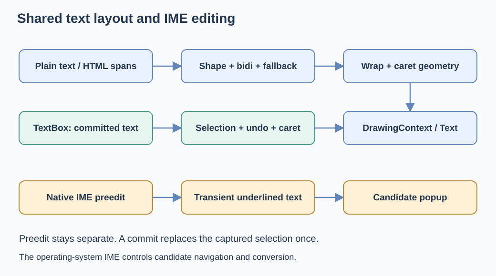

# Text, shaping, markup, and editing

[Documentation index](README.md) · [Text API contracts](api/text.md) · [Drawing](drawing.md)



## Draw first, retain when needed

All text paths share a paragraph engine: HarfBuzz shaping, Unicode bidirectional ordering, Unicode line breaks, and system-font fallback. Public types belong to Swealium. `Text` adds retained measurement to `DrawingContext.DrawText`; `TextBox` uses the same paragraph geometry for selection, hit testing, and caret placement.

```csharp
using Swealium.Graphics;
using Swealium.UI;

var label = new Text
{
    Content = "Hello · مرحبا بالعالم · שלום · 😀",
    Style = new TextStyle { FontSize = 22, Foreground = Color.White },
    Options = new TextOptions { Wrapping = TextWrapping.Word }
};
root.Children.Add(label);
```

Within `Draw`/`Paint`, draw a paragraph at a top-left rectangle:

```csharp
drawing.DrawText("A paragraph that wraps to its available width.",
    new Rect(20, 20, 300, 120),
    new TextStyle { FontSize = 20, FontFamily = "Arial" },
    new TextOptions { Alignment = TextAlignment.Start, MaxLines = 3, Ellipsis = true });
```

The older `(string, Point baseline, Color, float)` overload also shapes text. Its origin is a baseline and it does not wrap; explicit newlines still create lines. `MeasureText` uses this same unwrapped geometry. For measurement outside a drawing frame, create and dispose a `TextLayout`:

```csharp
using var paragraph = new TextLayout("Measured and shaped once", maxWidth: 300);
Size size = paragraph.Size;
TextPosition hit = paragraph.HitTest(new Point(40, 8));
Rect caret = paragraph.GetCaretRectangle(hit);
// During a drawing callback:
drawing.DrawTextLayout(paragraph, new Point(20, 20));
```

Layouts are immutable snapshots. Dispose them when finished; do not share them concurrently between UI threads. Font metrics and fallback vary by installed fonts and platform. Missing glyphs still require an appropriate installed font; shaping cannot invent font coverage. The backend remains CPU based.

## HTML as text markup

```csharp
root.Children.Add(new Text
{
    Content = "<h2>Welcome</h2><p><b>Bold</b> and <i>italic</i>, " +
              "<span style='color:#3366cc;font-size:20px'>colored text</span>.</p>",
    Markup = TextMarkup.Html
});
```

Plain is the default; `<b>` remains literal until HTML is explicitly selected. The HTML parser decodes entities and tolerates malformed HTML. Formatting inherits through nested tags. Supported markup:

| Markup | Behavior |
| --- | --- |
| `b`, `strong`, `i`, `em`, `u`, `s`, `del`, `strike` | Weight, italic, underline, strike-through |
| `sub`, `sup` | Subscript/superscript |
| `br` | Explicit newline |
| `p`, `div`, `blockquote`, `pre`, `li`, `h1`–`h6` | Block newlines; h1–h3 also adjust size/weight |
| `li` | Bullet prefix; ordered-list numbering is not implemented |
| `code`, `pre` | Requested monospace family; pre preserves whitespace |
| `span`, `font`, other passive tags | Descendant text and supported inline styles |
| `dir='ltr'` / `dir='rtl'` | Direction override for the run |
| Inline `color`, `background-color` | CSS hex RGB/RGBA and names red/green/blue/black/white/transparent |
| Inline `font-family`, `font-size`, `font-weight`, `font-style`, `text-decoration` | First family; positive px/em/% size; 1–1000 or normal/bold; italic/oblique; underline/line-through |

Whitespace outside pre collapses. Block breaks are newlines, not CSS boxes or paragraph margins. CSS stylesheets, selectors, full CSS layout, clickable links, images, resource loading, and JavaScript are absent. Script/style/iframe/object/noscript/svg/img content is omitted. Traversal stops beyond 256 nested elements. This is formatted text, not an embedded browser or an HTML editor. Use `TextRun` snapshots for programmatically styled spans.

## Editable plain text

```csharp
var editor = new TextBox
{
    Multiline = true,
    Height = 180,
    Text = "Edit me\nمرحبا",
    Placeholder = "Type here…",
    Style = new TextStyle { FontSize = 20 }
};
editor.TextChanged += () => SaveDraft(editor.Text);
root.Children.Add(editor);
window.Content = root;
window.Input.Focus(editor);
```

TextBox edits plain text; markup remains literal. It supports pointer drag selection/capture, Shift navigation, visual left/right movement in shaped lines, up/down, Home/End, PageUp/PageDown, Ctrl/Cmd+Home/End, word navigation with Ctrl/Cmd+Left/Right, select all, native clipboard copy/cut/paste, and undo/redo. Ctrl/Cmd+Z undoes; Shift+Ctrl/Cmd+Z or Ctrl/Cmd+Y redoes. Read-only editors remain selectable and copyable.

All public positions/ranges use .NET UTF-16 indices. Selection endpoints snap to extended grapheme boundaries. Backspace/Delete remove a grapheme, preserving surrogate pairs, combining marks, and joined emoji. Newlines normalize to LF; single-line editors replace newlines with spaces. Enter inserts a newline in multiline mode and raises `Submitted` in single-line mode. Tab remains focus navigation.

Undo retains up to 100 edit snapshots. Programmatic `Text` assignment clears history; `ReplaceSelection` creates an undoable edit. The control scrolls internally to reveal the caret, supports multiline wheel scrolling, and clips selection/text to its padded content area. Use [ScrollContainer](widgets/scroll-container.md) for a separately styled outer content viewport. TextBox does not expose password masking, syntax highlighting, document virtualization, spellcheck, or accessibility integration.

## IME preedit and candidates

Composition is separate from `Text`: underlined preedit and its selected segment are rendered temporarily. An eventual committed text event replaces the selection captured when composition started, as a single undo operation. Empty composition updates, focus loss, and cancellation clear preedit/candidates without changing committed text.

SDL editing and candidate events are copied before the next event poll. Native Unicode-character offsets convert to UTF-16. Custom widgets can opt in with `AcceptsTextInput`, override composition/candidate hooks, and supply a local `TextInputArea` to anchor native UI. The window translates that rectangle through ancestors into logical window coordinates each frame.

The application requests app-rendered composition/candidates through `SDL_IME_IMPLEMENTED_UI=composition,candidates` before video initialization. TextBox draws candidate snapshots over the visual tree, keeping the selected candidate visible. The IME owns keyboard navigation, conversion, and commit; the popup has no mouse selection protocol because SDL supplies no portable candidate-selection command. Availability depends on the SDL backend and input method. Some platforms retain native candidate UI instead. Environment hint overrides remain possible; use the default app UI mode for the built-in preedit display.

Automated tests inject composition/candidate events and verify ABI decoding, lifetimes, rendering, and commits. Interactive IME behavior still requires manual checks with each OS/provider; headless tests cannot establish that.

Run the interactive example:

```sh
dotnet run --project samples/Swealium.Sample -- --text-demo
```
