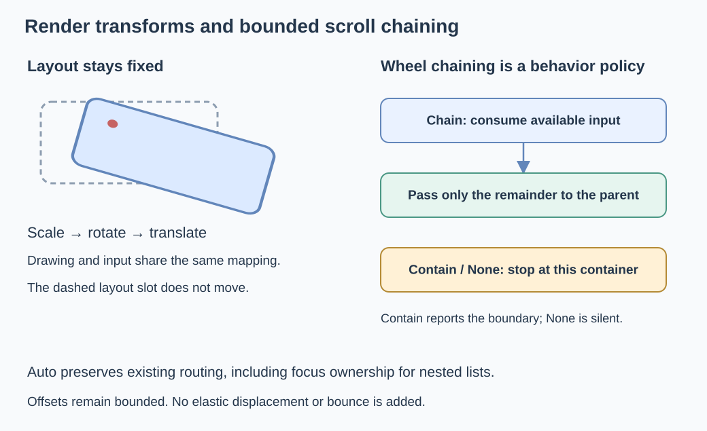

# Widget transforms and overscroll policies

[Documentation index](README.md) · [Widget](widgets/widget.md) · [ScrollContainer](widgets/scroll-container.md) · [List](widgets/list.md)



## Translate, scale, and rotate

```csharp
button.Transform = new Transform
{
    Translation = new Point(20, 8),
    Scale = new Size(1.2f, 0.9f),
    Rotation = 12,
    Origin = new Point(0.5f, 0.5f)
};
// Convenience factories:
button.Transform = Transform.Translate(20, 8);
button.Transform = Transform.ScaleBy(1.2f, 1.2f);
button.Transform = Transform.Rotate(15);
button.Transform = Transform.Identity;
```

Transform lives in Swealium.Graphics and is an immutable readonly record struct. Widget.Transform defaults to Identity, including for default(Transform). Translation defaults (0,0), Scale (1,1), Rotation 0 degrees, and Origin (0.5,0.5). Origin is relative to the widget's arranged size; it may lie outside [0,1]. Constructor `(Point translation, Size? scale=null, float rotation=0, Point? origin=null)` offers the same values. Components must be finite; parameterized construction and widget assignment reject invalid values with ArgumentOutOfRangeException.

The renderer scales around Origin, rotates clockwise around that pivot, then translates in parent logical coordinates. Layout position is applied afterward. Parent transforms compose around entire child subtrees, including strokes, text, images, overlays, and clipping. Negative scales mirror. Zero scale paints nothing and is not eligible for interaction. No shear, perspective, or animation scheduler is supplied.

This is a render transform: Bounds, ActualWidth/Height, DesiredSize, layout slots, and scrolling extents remain unchanged. Use ordinary X/Y, sizing, margin, or layout properties to reserve space. A transformed widget can overlap siblings or be clipped by its ancestors. ZIndex keeps controlling paint/hit order. Oversized transformed content does not automatically enlarge a scroll extent. BringIntoView uses the transformed descendant rectangle, clamped to the existing layout extent.

Pointer hit testing and bubbling invert the full transform chain, so PointerEvent.Position remains widget-local. WindowPosition stays in logical window coordinates. Rounded hit/clipping geometry remains exact in local space. Widget.ToWindow(Point), ToWindow(Rect), ToLocal(Point), and TransformedBounds help custom code map coordinates. Rect mapping returns a window-space axis-aligned enclosure of its four transformed corners. ToLocal throws InvalidOperationException for a noninvertible transform. Resolved coordinates that overflow the drawable range also throw InvalidOperationException rather than reaching the backend.

Native IME caret anchors and candidate overlays use transformed bounds. Accessibility snapshots expose axis-aligned transformed rectangles; rotated clipping is approximated by rectangular intersections in metadata, while semantic hit testing uses inverse geometry. Zero-scale elements are offscreen/noninteractive. Shared text selection also maps transformed widgets when finding drag endpoints.

## Overscroll behavior

```csharp
scroll.Overscroll = OverscrollBehavior.Auto;
list.Overscroll = OverscrollBehavior.Chain; // Inherited by List and subclasses.
scroll.BoundaryReached += boundary =>
    ShowBoundaryFeedback(boundary.UnconsumedDelta);
```

| Policy | Wheel behavior at a boundary |
| --- | --- |
| Auto (default) | Keeps existing behavior: consume when this container moves; otherwise bubble. Focus-owned nested scrolling keeps ownership. |
| Chain | Pass unused input to ancestors, including the remainder of a partially consumed wheel event. Explicitly allows chaining at a focus-owned nested boundary. |
| Contain | Scroll normally, stop parent chaining, and report unused input for optional application boundary feedback. |
| None | Scroll normally, stop chaining, and suppress boundary feedback notifications. |

Contain and None both keep offsets within [0, MaximumOffset]. None does not disable ordinary scrolling. No built-in elastic displacement, bounce animation, glow, or touch-pan recognizer is added. BoundaryReached is the behavior hook for application feedback under Auto, Chain, or Contain; None suppresses that hook. Programmatic scrolling, scrollbar dragging, and existing keyboard clamping remain bounded and do not raise wheel-boundary notifications.

`ScrollBoundaryEvent` is an immutable record containing UnconsumedDelta and current Offset. The delta uses normalized input wheel units, after Shift/horizontal direction mapping has been accounted for. It can include an unsupported axis. `PointerEvent.WheelDelta` retains the original input; read-only RemainingWheelDelta reports what is left after each scroll recipient. Chained ancestors multiply the remaining units by their own WheelStep, so differing scroll speeds do not double-consume the original event. New pointer events must be used per dispatch; their routing state is mutable internally.

Focus ownership remains in effect for a nested List: focus selects the inner or outer region. Chain changes what happens after the focused region consumes its available portion. Contain/None stop that remainder; Auto preserves the previous focus-owned containment rule. Ordinary ScrollContainer defaults stay unchanged. Policy values are validated; invalid enum values throw ArgumentOutOfRangeException.

Run `dotnet run --project samples/Swealium.Sample -- --transform-demo` for interactive transformed buttons and nested overscroll policies.
