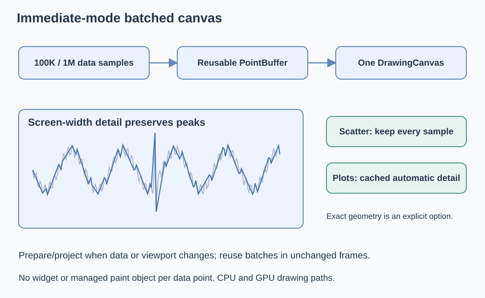

# DrawingCanvas

[Widget hub](README.md) · [Drawing](../drawing.md) · [Batch drawing contracts](../api/point-buffers.md) · [Performance measurements](../canvas-performance.md)

`public class DrawingCanvas : Widget` is an immediate-mode drawing surface inside the retained visual tree. Its Paint callback draws shapes, text, images, and large data batches without making a widget per point. It uses the window's existing GPU/raster surface; it creates no separate window or bitmap per frame.

```csharp
var points = new PointBuffer(samples); // ReadOnlySpan<Point>, copied/validated once.
var canvas = new DrawingCanvas((drawing, area) =>
{
    drawing.DrawPoints(points, new Color(80, 190, 240), size: 1, clip: area);
})
{
    Height = 400,
    Background = new Color(15, 20, 30)
};
```

Points use widget-local logical coordinates. For data coordinates, prepare `data.Project(area, sourceBounds)` when the canvas bounds/data change, then reuse the returned buffer. Do not re-project 100K samples every frame when nothing changed. Paint receives ContentBounds (including its local padding offset); it does not reset the drawing origin. Pass area as an optional batch clip to restrict drawing to that region.



## Public widget API

| Member | Default / contract |
| --- | --- |
| DrawingCanvas() | Empty drawing surface |
| DrawingCanvas(Action&lt;DrawingContext,Rect&gt; paint) | Subscribe initial callback; null rejected |
| Paint | Action&lt;DrawingContext,Rect&gt; event, once per Draw call for each subscriber |
| protected virtual OnPaint(DrawingContext,Rect) | Invokes Paint; subclass for custom immediate rendering |
| Background | Transparent; fills the widget's rounded bounds before Paint when alpha is nonzero |
| PreferredSize | (300,150), finite nonnegative intrinsic content size; setter invalidates layout |
| Detail | DrawingDetail.Automatic; validated; Exact opts out of automatic polyline reduction |
| Draw(DrawingContext) | Paint background/callback; reject reentrant painting; reset state after exceptions |

The renderer invokes Draw each visible frame. There is no private frame clock or invalidation cache: changing application state affects the next frame. Allocate buffers outside Paint and update them only when data changes. Use existing VectorImage.Create to record an entirely static scene if appropriate. DrawingContext expires after drawing and must not be retained. Callbacks run on the UI thread; worker computation should transfer completed data onto that thread before painting.

DrawingCanvas is not a Container. Compose surrounding controls with Container/Grid and draw the data within a single canvas. All ordinary Widget layout, transform, opacity, outline/stroke, rounded clipping, z-index, pointer targeting, focus, and accessibility metadata remain available. Override ContainsPoint for a different surface shape. Pointer events target the canvas, not individual samples; use application hit tests/spatial indexes for per-datum picking. ConsumePointer=false makes a canvas overlay pointer-transparent.

## Large data path

PointBuffer stores contiguous validated coordinates and reuses storage for equal-size updates. DrawPoints renders a marker series in one native batch; DrawLines renders pairs; DrawPolyline renders connected segments. One paint describes the series, avoiding per-point objects/paint allocations. Scatter batches always retain all input samples. Marker shape/size, line cap/width, alpha, gradients, anti-aliasing, and optional clipping are configurable. Zero width/size requests a device-pixel hairline.

Automatic detail applies only to open, nondecreasing-X polylines when their point count exceeds four times their visible pixel width. The first/last/minimum-Y/maximum-Y samples of each X column are retained in source order, preserving spikes while bounding drawing work. Adjacent offscreen samples retain line continuity. Four recently generated reductions are cached per buffer; Update invalidates them. Device scale/rotation and local clip determine the pixel budget, capped at 32,768 columns. No widgets are allocated per sample. Exact mode, closed polylines, unordered paths, line-pair batches, and scatter batches do not use this approximation.

```csharp
var plot = new DrawingCanvas((drawing, area) =>
    drawing.DrawPolyline(projectedSeries, Color.White, clip: area));
plot.Detail = DrawingDetail.Exact; // Preserve every segment, with its full cost.
```

General DrawingContext.PolylineDetail defaults Exact outside DrawingCanvas. The canvas scopes its chosen policy to Paint and restores the caller's value afterward. Batch polylines consist of stroked segments; caps are configurable, but they do not promise the miter/bevel joins of a stroked VectorPath. Use VectorPath where exact joined path geometry is required.

Automatic reduction is a display approximation, not a replacement for the source data or numerical analysis. Exact anti-aliased 100K+ paths and large/translucent markers can be expensive even when batching avoids managed overhead. GPU driver, pixel count, overdraw, and compositor/presentation all affect frame rate. See [measured CPU/GPU costs and reproducible commands](../canvas-performance.md).

Run `dotnet run --project samples/Swealium.Sample -- --canvas-demo` to switch between 100K/1M samples, scatter/plot rendering, and automatic/exact detail. The demo caches projections on resize/data changes and draws a pointer crosshair without per-sample widgets.

The canvas is a single semantic/custom widget, not an accessibility node per point. Supply Accessibility.Name/Description and an appropriate summary or companion controls for chart data using the existing accessibility boundary.
