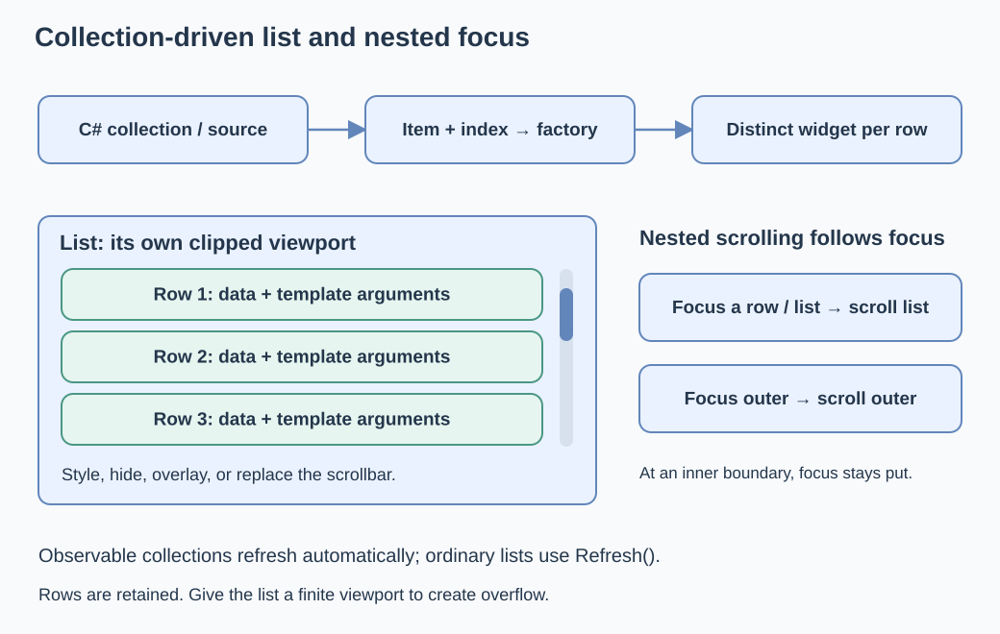

# List

[Widget hub](README.md) · [ScrollContainer](scroll-container.md) · [Complete signatures](../api/reference.md#swealium-ui-list)

`public class List : ScrollContainer` repeats an item widget for each collection value. It owns its own scroll viewport and inherits layout, colors, spacing, strokes, clipping, scrolling APIs, and fully customizable scrollbars. It defaults to a vertical stack and vertical scrolling. A finite height (or a parent allocation through Fill/Weight) is required for overflow; unbounded height expands to fit the rows.

```csharp
using Swealium.UI;

var people = new System.Collections.Generic.List<Person>
{
    new("Ada", 36), new("Lin", 29)
};
var list = Swealium.UI.List.Create(people, (person, index) =>
{
    var row = new Button
    {
        Text = $"{index + 1}. {person.Name}, {person.Age}",
        Height = 48
    };
    row.Click += () => OpenPerson(person);
    return row;
});
list.Height = 280;
list.Gap = 6;
list.Padding = new(8);

record Person(string Name, int Age);
```

Use arrays, System.Collections.Generic.List&lt;T&gt;, read-only collections, LINQ sequences, or other IEnumerable sources. Strongly typed factories accept `(T item)` or `(T item, int index)`. Capture additional constructor arguments/settings in the factory closure; pass each model's values into widget properties or constructors. Each row can be any Widget, including a container with several controls. There is no reflection-based constructor invocation and no backend type in the public API.

The widget itself is nongeneric `Swealium.UI.List`, so it coexists with C# `List<T>` without making generic collection names ambiguous. It can be subclassed; override CreateItem(object?,int) for custom default rows when ItemTemplate is null.



## Source and template contracts

| API | Default / contract |
| --- | --- |
| List() | Empty source, default text template |
| List(IEnumerable items, Func&lt;object?,int,Widget&gt; itemTemplate) | Untyped indexed factory; source/factory must be nonnull |
| List(IEnumerable items, Func&lt;object?,Widget&gt; itemTemplate) | Untyped factory without index |
| static Create&lt;T&gt;(IEnumerable&lt;T&gt;, Func&lt;T,int,Widget&gt;) | Strongly typed list construction |
| static Create&lt;T&gt;(IEnumerable&lt;T&gt;, Func&lt;T,Widget&gt;) | Strongly typed construction without index |
| ItemsSource | IEnumerable? null; null clears rows; setting rebuilds with the current template |
| ItemTemplate | Func&lt;object?,int,Widget&gt;? null; null uses CreateItem |
| Items | IReadOnlyList&lt;object?&gt; of the current data snapshot |
| ItemWidgets / Children | IReadOnlyList&lt;Widget&gt; snapshots in item order; rows are data-owned |
| Count | Snapshot count |
| SetItems&lt;T&gt;(source, factory) | Indexed/nonindexed overloads; bind a typed source/template together |
| Refresh() | Enumerate the current source once and regenerate rows |
| ScrollToItem(int index) | Reveal that generated widget through BringIntoView; invalid indices throw ArgumentOutOfRangeException |
| ItemsChanged | Action after a successful rebuild; rows/source are committed before notification |
| protected virtual CreateItem(object?,int) | Default returns Text with item.ToString(), or empty text for null |

Factories must return a distinct, nonnull widget per row. Widgets already in unrelated trees, visual ancestors, and window/input roots are rejected. Existing rows belonging to this list may be returned again to preserve their state. Enumeration and row validation complete before the current view/source listener is replaced; a failing factory/duplicate/ownership check preserves the old view. Source collection mutations themselves are outside that transaction. Do not mutate the list/source from an item factory; reentrant rebuilds throw InvalidOperationException.

Rebuild methods and observable callbacks require the creating UI thread; worker-thread calls throw InvalidOperationException. Null typed construction/binding arguments throw ArgumentNullException. Other enumeration/factory exceptions propagate. Item widget resources remain application-owned, following ordinary Widget ownership; removing rows does not dispose borrowed bitmaps or application data.

Items/ItemWidgets/Children wrappers are read-only snapshots. Do not modify the inherited Container child collection through a base-class cast: rebuilding replaces it. Row widgets themselves remain customizable. All rows are retained and measured; this implementation does not virtualize/recycle automatically. Large data sets should be paged by the application. A factory cache may return existing owned rows, but automatic diffing/key selection and selected-item state are not supplied.

## Collection changes

ObservableCollection&lt;T&gt; and other INotifyCollectionChanged sources refresh automatically on add/remove/replace/move/reset, using new indices. The subscription is weak with respect to the widget, and rebinding detaches the old listener. A long-lived source therefore does not retain an otherwise unreferenced list. Change the collection on the UI thread.

Ordinary List&lt;T&gt;/array changes need Refresh. Model property changes also need Refresh or application bindings within the row; INotifyPropertyChanged is not interpreted automatically. A rebuild normally creates new rows and loses their local focus/editor state unless the factory returns cached existing rows. Offset is retained and clamped on the next layout/scroll operation.

## Scrolling and customization

All ScrollContainer APIs are inherited: Direction, Offset, HorizontalOffset/VerticalOffset, MaximumOffset, Extent/Viewport, ScrollTo/ScrollBy/BringIntoView, WheelStep, ScrollChanged, bar visibility, OverlayScrollBars, and horizontal/vertical ScrollBarStyle. Hide a scrollbar with ScrollBarVisibility.Hidden while retaining wheel/programmatic scrolling, or draw external controls using the bar metrics. Override DrawScrollBar for custom painting with the standard hit geometry. See [scrollbar contracts](scroll-container.md).

```csharp
list.VerticalScrollBarStyle = new ScrollBarStyle
{
    Thickness = 12,
    ThumbColor = new(80, 150, 220),
    TrackColor = new(25, 35, 50)
};
list.ScrollToItem(1);
// Horizontal list:
list.Layout = LayoutMode.Horizontal;
list.Direction = ScrollDirection.Horizontal;
```

Set a finite row width for horizontal lists. Item widgets can use the same Radii/Stroke/Opacity/Cursor/input customization as any other widget. Accessible row controls remain in the visual/semantic tree; the list inherits the ScrollArea semantic role and scroll actions.

## Nested focus ownership

List sets RequireFocusForNestedScrolling=true (ordinary ScrollContainer defaults false). For an overflowing list nested inside another scroll container:

- Focus the list or one of its row descendants to scroll the list.
- Focus the outer container or an outer control to scroll the outer container.
- With the default Overscroll=Auto, a focused list keeps wheel ownership at its edges; wheel input does not leak into the parent. Explicit Chain allows unused input to pass onward.
- Wheel input inside the ancestor viewport follows that focused list even when the pointer is outside its row area.

Clicks and scrollbar presses establish focus through normal input routing; Input.Focus(list) is also available. This focus gate applies only while nested and overflowing; standalone lists scroll on hover normally. Set RequireFocusForNestedScrolling=false to restore ordinary pointer-based boundary bubbling. Existing scroll containers keep their previous defaults. Explicit programmatic scrolling and scrollbar dragging are unaffected.

Run `dotnet run --project samples/Swealium.Sample -- --list-demo` for a templated observable list inside another scroll container, row actions, scrollbar styling, and focus switching.

See [widget transforms and overscroll policies](../transforms-and-overscroll.md) for coordinate mapping, render-only scale/rotation/translation, boundary feedback, and chaining.
