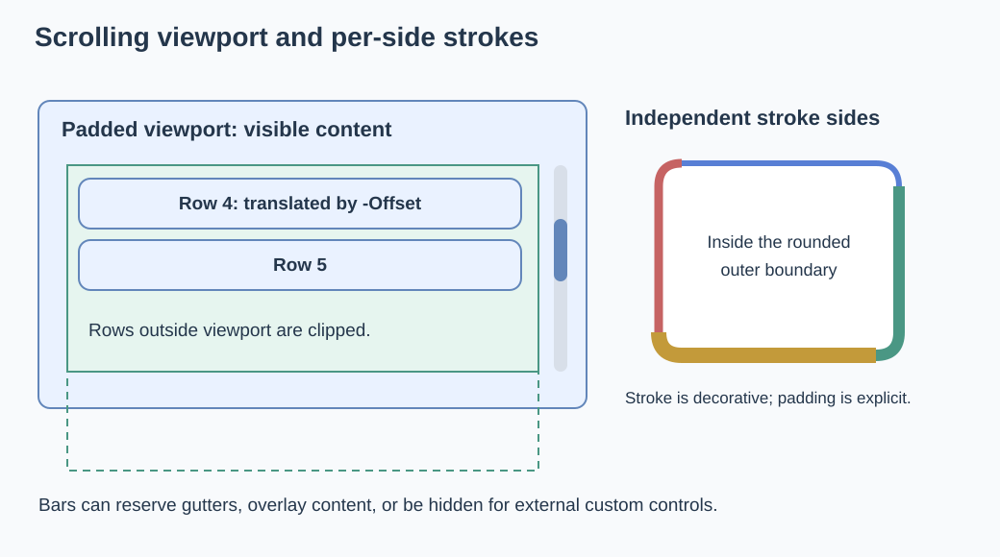

# ScrollContainer

[Widget hub](README.md) · [Inherited Container API](container.md) · [Generated signatures](../api/reference.md#swealium-ui-scrollcontainer)

`public class ScrollContainer : Container` arranges an extent behind a clipped viewport. It supports vertical, horizontal, both-axis, or disabled scrolling, nested wheel routing, focus reveal, keyboard scrolling, draggable thumbs, and configurable/custom bars. Children use inherited Container.Layout; wrap/grid content can be nested in a child layout container.



## Basic use

```csharp
var scroll = new ScrollContainer
{
    Height = 300,
    Direction = ScrollDirection.Vertical,
    Gap = 8,
    Padding = new(12),
    Background = new(245, 247, 250)
};
for (int i = 0; i < 50; i++)
    scroll.Children.Add(new Button { Text = $"Item {i + 1}", Height = 44 });
root.Children.Add(scroll);
```

Give the scroller a **finite viewport**: explicit Height/Width, a finite grid cell, or a weighted slot. Unbounded measurement sizes to content and consequently has no overflow on that unbounded axis. Vertical scrolling keeps content width constrained, allowing Text wrapping. Horizontal scrolling measures content width unbounded. Both measures both axes unbounded, suitable for large canvases/grids with explicit/intrinsic extents.

## Public properties and methods

| Member | Default / contract |
| --- | --- |
| Direction | Vertical; flags None=0, Horizontal=1, Vertical=2, Both=3; unknown bits rejected |
| HorizontalScrollBarVisibility / VerticalScrollBarVisibility | Auto; Always shows an enabled axis even without overflow; Hidden removes drawing/hit region/gutter but retains scrolling |
| HorizontalScrollBarStyle / VerticalScrollBarStyle | Separate new default immutable ScrollBarStyle records; null/invalid geometry rejected |
| OverlayScrollBars | false: reserve gutters; true: bars draw above content |
| WheelStep | 40 logical units per wheel unit; finite nonnegative |
| Offset | Read-only Point; current horizontal/vertical logical displacement |
| HorizontalOffset / VerticalOffset | Get/set individual offset through ScrollTo |
| MaximumOffset | Read-only Point; max(0, extent minus viewport) on enabled axes, zero otherwise |
| Extent | Read-only unscrolled content Size, at least viewport size |
| Viewport | Read-only local Rect excluding padding and reserved gutters |
| HorizontalScrollBar / VerticalScrollBar | Read-only current ScrollBarInfo snapshots |
| ScrollTo(float horizontal,float vertical) | Finite arguments, clamp to enabled-axis ranges |
| ScrollBy(float horizontal,float vertical) | Finite deltas, clamp; negative moves toward origin |
| BringIntoView(Rect bounds) | Minimally reveal an unscrolled content-coordinate rectangle; requires finite position/nonnegative finite size |
| BringIntoView(Widget descendant) | Reveal arranged descendant bounds; null/unrelated widgets rejected; self is a no-op |
| ScrollChanged | Action&lt;ScrollChangedEvent&gt; after offset, viewport, or extent changes |
| DrawOverlay(DrawingContext) | Public override drawing bars after children |
| DrawScrollBar(DrawingContext, ScrollBarInfo) | Protected virtual full drawing override for each visible bar |
| MeasureContent / ArrangeContent | Protected overrides resolving gutters, content extent, viewport, offsets, and arranged children |

Constructor sets IsFocusable=true. Background, Radii, Stroke, Gap, Layout, child ownership, alignment, sizing, and all Widget events are inherited. Geometry snapshots are zero before first arrangement. Scroll methods refresh pending layout when the tree has a known LayoutEngine viewport; before any arrangement there is no scroll range. Invalid direction/visibility/style/delta/rectangle values throw ArgumentOutOfRangeException; unrelated descendants throw ArgumentException.

Offsets clamp when content shrinks, the viewport resizes, or an axis disables. Auto bar visibility resolves both axes together: a reserved vertical gutter can cause horizontal overflow and vice versa. Hidden or overlay bars reserve no space. Content is always clipped to Viewport for drawing **and** descendant hit testing, including when ClipToBounds=false. Rounded outer clipping still applies when enabled.

Scrolling rearranges child Bounds by Viewport origin minus Offset; rendering, local input, and native IME anchor translation therefore agree. It does not mutate child X/Y requests. Stroke is decorative and does not shrink the viewport. ScrollChangedEvent provides PreviousOffset, Offset, Extent, and Viewport; it can fire during arrangement, so handlers should update UI state rather than recursively force layout.

BringIntoView uses coordinates relative to the unscrolled content origin (excluding viewport/padding origin). It moves only enabled axes. If a requested rectangle already covers an entire viewport axis, that axis remains in place; if an oversized rectangle lies beyond the visible area, its leading edge is revealed. InputManager automatically reveals a focused descendant through its ancestor scroll containers, innermost first. There is no automatic scrolling animation or inertia.

## Style both axes independently

```csharp
scroll.VerticalScrollBarStyle = new ScrollBarStyle
{
    Thickness = 16,
    Inset = 3,
    MinimumThumbLength = 36,
    TrackColor = new(225, 230, 240),
    ThumbColor = new(85, 110, 165),
    HoverThumbColor = new(65, 95, 155),
    PressedThumbColor = new(40, 70, 130),
    TrackRadii = new(8),
    ThumbRadii = new(3, 8, 3, 8)
};
scroll.HorizontalScrollBarStyle = scroll.VerticalScrollBarStyle with { Thickness = 10 };
```

| ScrollBarStyle property | Default |
| --- | --- |
| Thickness | 12; finite positive gutter/bar thickness |
| Inset | 2; finite nonnegative inset within the bar allocation |
| MinimumThumbLength | 24; finite nonnegative, clamped to available track length |
| TrackColor | RGB(225,228,235) |
| ThumbColor | RGB(135,145,160) |
| HoverThumbColor | RGB(105,120,145) |
| PressedThumbColor | RGB(65,95,145) |
| TrackRadii / ThumbRadii | Uniform 6 |

Inset clamps to half the track's smaller dimension; extreme styles can produce zero-area tracks. Thumb length is proportional to viewport/extent and capped by the track. Without overflow an Always thumb fills its track. When both bars show, their tracks leave the shared corner clear. Hover styling means the pointer is over the track; pressed styling means the thumb is being dragged.

ScrollBarInfo is an immutable readonly record with Axis (ScrollAxis.Horizontal/Vertical), IsVisible, local Track/Thumb rectangles, Offset, MaximumOffset, ViewportLength, ExtentLength, IsHovered, and IsDragging. Invisible bars have empty rectangles. Shapes drawn by custom code do not change the standard rectangular hit geometry.

## Fully custom drawing

```csharp
public sealed class ThinScrollContainer : ScrollContainer
{
    protected override void DrawScrollBar(DrawingContext drawing, ScrollBarInfo bar)
    {
        drawing.FillRectangle(bar.Track, new Color(30, 35, 45));
        drawing.FillRectangle(bar.Thumb,
            bar.IsDragging ? new Color(100, 180, 255) : new Color(75, 130, 200),
            new CornerRadii(2));
    }
}
```

This replaces all default bar drawing while retaining track paging, thumb dragging, clipping, and capture. Use style Thickness/Inset/MinimumThumbLength to control hit geometry. Override OnPointerInput if replacing interaction as well; call base to retain its behavior.

## Disable bars and supply external controls

```csharp
scroll.HorizontalScrollBarVisibility = ScrollBarVisibility.Hidden;
scroll.VerticalScrollBarVisibility = ScrollBarVisibility.Hidden;

var down = new Button { Text = "Next page" };
down.Click += () => scroll.ScrollBy(0, scroll.Viewport.Height);
scroll.ScrollChanged += change => UpdateCustomIndicator(change.Offset, change.Extent, change.Viewport);
```

Hidden disables the built-in bar's visuals and hit regions, without disabling offset, wheel, keyboard, or focus scrolling. An external thumb/control can set HorizontalOffset/VerticalOffset or call ScrollTo using MaximumOffset for its normalized range. Custom controls are ordinary sibling widgets; no backend scrollbar types are exposed.

## Input and limitations

Wheel uses both delta axes. Holding Shift maps a vertical wheel to horizontal movement and suppresses vertical movement; a native already-horizontal delta is preserved without being swapped again. A horizontal-only scroller also maps an unmodified vertical wheel horizontally. PointerEvent.Modifiers carries the event's modifier state, including for custom input hosts. A scroll container handles a wheel event only when its offset changes, allowing nested boundary events to bubble outward. A vertical-only inner scroller leaves Shift+wheel for a horizontal ancestor. TextBox follows the same rule for its applicable internal wheel range. A partially consumed wheel event is handled as a whole; residual deltas are not split between ancestors.

Primary thumb down captures through InputManager, dragging clamps even outside the viewport, and Up/Cancel ends dragging. Track clicks move one viewport toward the pointer. Bars take hit priority over scrolled children, including overlay bars. They have no separate focusable Widget objects. When the scroller itself is focused, arrows move by WheelStep, PageUp/Down by a viewport, and Home/End move to range endpoints. Key events already consumed by a focused editor/button are not repurposed for scrolling.

This is retained scrolling, not virtualization: all children still measure/draw under clipping. Scrollbar drags have independent pointer ownership, including simultaneous drags on different axes. There is no pinch recognizer, kinetic scrolling, auto-repeat track paging, or scroll animation. Semantic scroll actions are exposed through the [accessibility boundary](../accessibility.md). Run `dotnet run --project samples/Swealium.Sample -- --scroll-demo` for a working example.

## Focus-owned nested scrolling

RequireFocusForNestedScrolling defaults false and preserves pointer-based boundary bubbling. Set it true to let an overflowing nested scroll container own wheel input while it or a descendant is focused. The focused inner container keeps ownership at its edges; ancestors forward wheel input to it rather than scrolling themselves. Focus an outer container/control to transfer ownership back. This does not change programmatic offsets or scrollbar dragging. [List](list.md) enables the policy by default.

See [widget transforms and overscroll policies](../transforms-and-overscroll.md) for coordinate mapping, render-only scale/rotation/translation, boundary feedback, and chaining.
