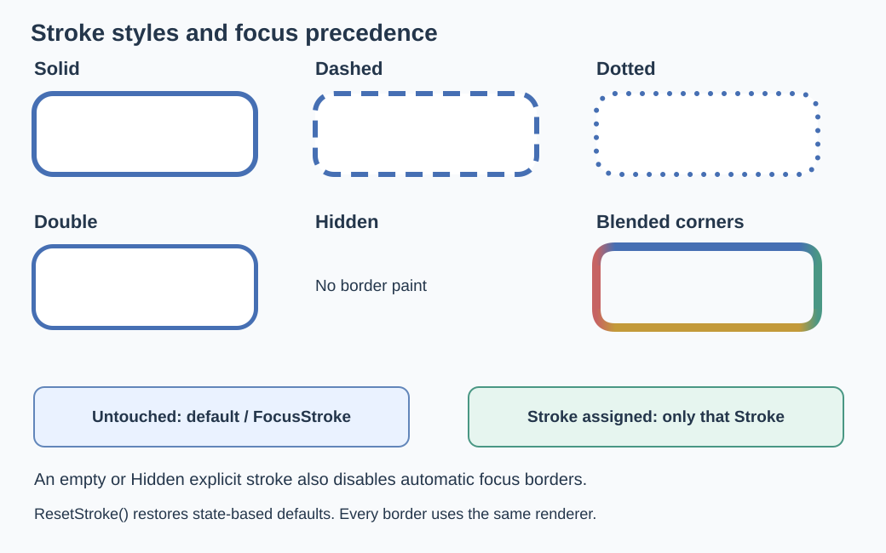

# Widget

[Widget hub](README.md) · [Complete base contracts](../api/widgets.md#widget) · [Signatures](../api/reference.md#swealium-ui-widget)

`public abstract class Widget` is the retained visual base. Its protected constructor creates no native resources. Implement `Draw(DrawingContext)`; optionally override measurement, arrangement, input, and overlay hooks. Widget is not IDisposable. A widget belongs to one parent or one input-tree root at a time.

## Layout and observed geometry

| Public input | Default / behavior |
| --- | --- |
| X / Y | 0, finite; used by Absolute parent layout |
| Width / Height | NaN: automatic; otherwise finite nonnegative requested dimensions |
| WidthSizing / HeightSizing | Automatic; Content keeps intrinsic size, Fill occupies allocated slot; named values clear numeric size |
| MinWidth / MinHeight | 0, finite nonnegative |
| MaxWidth / MaxHeight | PositiveInfinity; minimum wins if contradictory |
| Margin / Padding | Zero Thickness; outer / inner spacing in left, top, right, bottom order |
| HorizontalAlignment / VerticalAlignment | null: inherit parent defaults |
| Grow / Weight | 0; aliases for the same finite nonnegative spare-space weight |
| WeightBasis | Content; Zero starts weighted cells at minimum+margin |
| GridRow / GridColumn | 0; nonnegative explicit Grid placement |
| GridRowSpan / GridColumnSpan | 1; positive cell span |
| ZIndex | 0; signed paint/hit order, independent of layout order |

Invalid nonfinite/negative lengths and undefined sizing/weight enums throw ArgumentOutOfRangeException. Numeric Width/Height assignment restores Automatic. Layout-affecting setters invalidate the widget and ancestor measurements.

Read-only `Bounds` is parent-relative; before arrangement it derives from X/Y and numeric requested sizes. `ActualWidth/ActualHeight` are its dimensions. `DesiredSize` includes margins. `ContentBounds` is local and inset by padding. `Parent`, `IsLayoutValid`, `IsFocused`, and `IsPointerOver` describe current ownership/state.

`Measure(Size)` accepts finite or positive-infinite constraints and caches identical requests. `Arrange(Rect)` requires a finite nonnegative slot and prior measurement for automatic sizing. `InvalidateLayout()` clears measurement validity through ancestors. Protected `MeasureContent(Size)` returns finite nonnegative content demand (default zero); `ArrangeContent(Rect)` arranges descendants (default empty). A custom intrinsic-property setter must invalidate layout. Windows run LayoutEngine automatically; standalone trees can use LayoutEngine.Layout.

## Per-side strokes



`Stroke` returns the effective border. An untouched base Widget has `default(Stroke)`: four zero-width transparent sides. Each `StrokeSide` has a validated finite nonnegative Width, Color, and StrokeStyle (default Solid). Configure uniformly or independently:

```csharp
using Swealium.Graphics;

widget.Stroke = new Stroke(2, new Color(90, 120, 180));
widget.Stroke = new Stroke(
    left: new StrokeSide(4, new Color(230, 70, 70)),
    top: new StrokeSide(2, new Color(70, 120, 230), StrokeStyle.Dashed),
    right: new StrokeSide(6, new Color(60, 180, 110), StrokeStyle.Dotted),
    bottom: new StrokeSide(8, new Color(220, 170, 40), StrokeStyle.Double));
widget.Radii = new CornerRadii(20, 4, 12, 0);
widget.Padding = new Thickness(12);
```

Constructors also accept `StrokeSide uniform` or `(Thickness widths, Color color, StrokeStyle style = Solid)`. Uniform `(width,color,style)` construction applies the same style to all sides. Side order is **left, top, right, bottom**, matching Thickness. The rounded outer boundary follows normalized CornerRadii. Inner corners inset independently on each axis; adjacent colors blend smoothly along each curved corner. Opposing widths that exceed the widget's dimensions scale to fit. Transparent sides remain unpainted.

| StrokeStyle | Rendering |
| --- | --- |
| Solid | Continuous rounded band |
| Dashed | Marks/gaps follow the border perimeter, approximately three widths each |
| Dotted | Round dots follow the perimeter, approximately two widths between centers |
| Double | Outer/inner thirds painted, middle third clear |
| Hidden | No paint or effective border width for that side |

Patterns continue around curved corners instead of terminating as straight-edge decorations. Different side styles hand over at the middle of the corner. Very fine patterns use a minimum logical sampling scale and bounded tessellation work. Borders remain decorative and do not reserve layout space.

Strokes draw automatically after Draw, descendants, and DrawOverlay, including for custom widgets. They are decorative, inside the outer bounds, and do not change DesiredSize, ContentBounds, hit regions, or padding. Add padding explicitly to keep content clear. `DrawOverlay(DrawingContext)` is a public virtual no-op hook for drawing above descendants, before the stroke. Each drawing callback gets its own expiring context.

### Default, focus, and explicit stroke precedence

`FocusStroke` is a public settable Stroke, rendered by the same renderer as every other stroke. Button initializes it to a 2-unit white solid border; TextBox initializes it to a 1-unit blue solid border. The base default is empty. Protected virtual `GetDefaultStroke()` supplies the resting border (empty in Widget/Button, BorderColor-based in TextBox).

Assigning **any** Stroke sets `IsStrokeSet=true` and suppresses automatic resting/focus styling, even if that value is empty, transparent, or Hidden. Focus changes and FocusStroke changes never overwrite an explicit Stroke. No OnFocusChanged handler is needed. `ResetStroke()` clears that explicit assignment, sets IsStrokeSet=false, and restores state-based appearance immediately.

```csharp
button.FocusStroke = new Stroke(2, new Color(80, 150, 230), StrokeStyle.Dashed);
button.Stroke = new Stroke(3, new Color(180, 70, 100)); // same border, focused or not
button.Stroke = default; // explicitly disable all automatic borders, including focus
button.ResetStroke();   // restore automatic focus styling
```

## Appearance and input

`Radii` defaults to zero; `ClipToBounds=true` clips the subtree and hit testing to the normalized rounded shape. `ContainsPoint(Point)` is virtual and uses that shape by default. Overriding it changes hit membership, not drawing. ScrollContainer additionally clips descendants to its viewport even with ClipToBounds=false.

`IsVisible=true` controls collapsed layout and drawing/input. `IsEnabled=true` preserves layout/drawing but gates input through ancestors. `IsHitTestVisible=true` controls subtree pointer eligibility. `IsFocusable=false` and `AcceptsTextInput=false` opt into focus/text services when set. `TextInputArea` is a virtual local rectangle defaulting to ContentBounds; windows translate it to anchor native IME UI.

| Event | Protected virtual hook called first |
| --- | --- |
| Click | OnClick() |
| PointerInput | OnPointerInput(PointerEvent) |
| KeyboardInput | OnKeyboardInput(KeyEvent) |
| TextInput | OnTextInput(TextInputEvent) |
| CompositionInput | OnCompositionInput(TextCompositionEvent) |
| CandidatesInput | OnCandidatesInput(TextCandidatesEvent) |
| FocusChanged | OnFocusChanged() |

`PerformClick()` checks effective visibility/enablement and raises OnClick/Click. It does not require a pointer gesture or focus. Public virtual OnMouseDown/Up/Move(float x,float y) are legacy hooks called by base OnPointerInput. Typed events preserve button, wheel, key, selection, and routing information. Handled stops further bubbling. InputManager owns capture, hover, and focus; Tab traverses eligible widgets in insertion order and reveals focused descendants in scroll containers.

## Deriving a widget

```csharp
public sealed class Swatch : Widget
{
    public Color Fill { get; set; } = new(90, 130, 200);
    protected override Size MeasureContent(Size available) => new(40, 24);
    public override void Draw(DrawingContext context) =>
        context.FillRectangle(new Rect(0, 0, ActualWidth, ActualHeight), Fill, Radii);
}
```

Draw in local logical units, use ActualWidth/Height, and do not retain DrawingContext. See [custom widgets](../custom-widgets.md) and [input contracts](../api/input.md) for routing/lifetime details.
