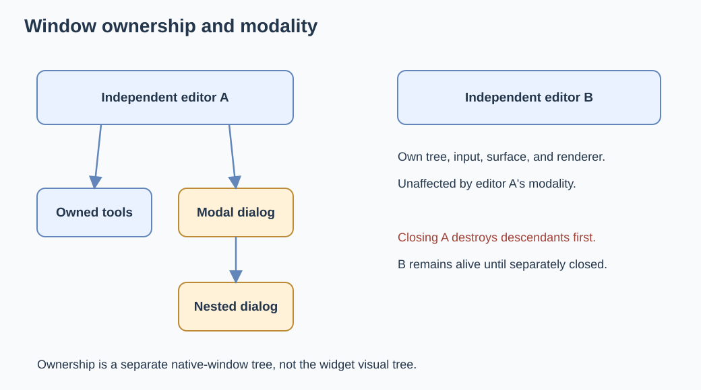

# Windows, controls, and events

[Documentation index](README.md) · [Contracts](api/windowing.md) · [Signatures](api/reference.md#swealium-swealiumwindow)



## Independent and owned windows

Inside Run, create an independent window with SwealiumApplication.CreateWindow(options). Constructing a SwealiumWindow subclass inside the session also registers it. Closing the original window does not end the app while another independent window remains.

Create an owned child with owner.CreateChild(options), or pass owner to the window constructor. This creates a separate OS-owned window, not an embedded widget. Native ownership is set during creation. Owner is immutable; close and recreate to use another owner.

```csharp
var editor = SwealiumApplication.CreateWindow(new()
{
    Title = "Editor", Width = 900, Height = 600
});
var tools = editor.CreateChild(new()
{
    Title = "Tools", Width = 320, Height = 400, ShowInTaskbar = false
});
```

An owner cannot be disposed while it or a descendant is rendering. Use RequestClose from drawing callbacks. Destroying an owner forcibly destroys descendants first; their close vetoes do not keep native children alive after their owner.

## Requested versus observed geometry

Position and Size get current native integer geometry. Setters request OS changes; compositor policies may deny/adjust/delay them. ClientSize is the cached logical viewport used by layout. PixelSize is physical drawable size. Do not confuse PixelDensity with widget scale coordinates or persist physical dimensions as logical sizes.

MinimumSize/MaximumSize use logical integers; zero means no constraint on that axis. A nonzero maximum below the minimum is rejected. To change both sides of an existing constraint range, loosen the blocking bound first.

```csharp
editor.MinimumSize = new(400, 300);
editor.MaximumSize = new(1600, 1200);
editor.Size = new(1024, 720);
editor.Center();
```

Center requests primary-display centering, not owner-relative centering. Wayland and other managers can restrict absolute positioning.

## State and behavior

Use Show/Hide or IsVisible to map/unmap a window. Hiding is not closing: a hidden window keeps Run alive. Activate shows the window and requests OS activation; a manager may reject focus stealing. Activating a blocked modal owner is rejected.

Minimize, Maximize, Restore, State, and IsFullscreen submit native state requests. Restore also leaves fullscreen. State reads native flags with priority Minimized, Fullscreen, Maximized, Normal.

Resizable, Borderless, AlwaysOnTop, Focusable, MouseGrabbed, KeyboardGrabbed, and Opacity have native setters. Unsupported features throw InvalidOperationException with SDL's error. Do not use input grabbing as a substitute for framework pointer capture. ShowInTaskbar and HighPixelDensity are read-only after creation in this API; set them in WindowOptions.

Flags is an observed snapshot of Swealium enum values, not an SDL bitmask to feed into native APIs. HasFocus/HasMouseFocus track focus events. IsVisible/IsMinimized/IsMaximized/IsOccluded and the control getters query native flags.

## Window events and subclassing

```csharp
editor.FocusChanged += focused => Console.WriteLine($"Focused: {focused}");
editor.Resized += logical => Console.WriteLine($"Logical client: {logical}");
editor.PixelSizeChanged += pixels => Console.WriteLine($"Pixels: {pixels}");
editor.Closing += e =>
{
    if (MessageBox.Confirm("Close", "Close this editor?", editor) != DialogResult.Yes)
        e.Cancel = true;
};
```

Focus loss, hiding, and minimize notifications cancel framework interaction before window event callbacks. Repeated identical focus, mouse-focus, visibility, and state transitions are suppressed. Move/resize events carry the native notification payload; a live getter can already reflect a newer requested geometry if multiple changes were queued.

Subclass hooks include parameterless OnFocusChanged/OnMouseFocusChanged and typed hooks for geometry/state/display notifications. Call base to preserve event subscribers. OnPaint is behind the visual tree; overriding it does not replace widget rendering.

```csharp
public sealed class EditorWindow : SwealiumWindow
{
    public EditorWindow() : base(new WindowOptions { Title = "Editor" }) { }
    protected override void OnFocusChanged()
    {
        base.OnFocusChanged();
        Console.WriteLine($"Editor active: {HasFocus}");
    }
}
```

Do not invoke virtual hooks as synthetic native-state setters. Their base implementations raise events; they do not change OS state. Use the control API.

## Closing and session shutdown

RequestClose raises Closing unless already closing/requested. Cancel=true leaves the window alive. Closed occurs once after native teardown and unregistering. Dispose bypasses cancellation and is idempotent.

Exit and SDL's global quit event request close on the current snapshot of all windows; close handlers may veto. Closing the last registered window ends the session after pending UI callbacks are processed. Applications should avoid creating replacement windows from shutdown handlers unless that is intentional.

See [dialogs](dialogs.md) for owner blocking and task completion, and [native interop](native-interop.md) for IDs/handles.

